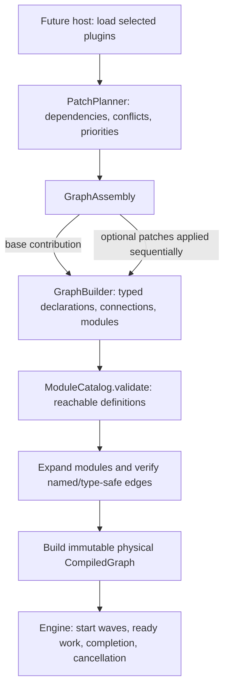

# Phenix graph prototype: assembly → compilation → execution

Status: implemented prototype APIs with unverified Rust compilation in this
artifact-generation environment. This is **not** a plugin loader,
security system, or harness. A pre-compilation `PatchPlanner` is now included.

## System boundary



- **GraphBuilder** owns mutable *authoring* declarations and typed handles. The
  functions it registers belong to application code. No graph macro is necessary.
- **GraphAssembly** owns a pre-compilation edit transaction log. A contribution
  is called **before** compilation, receives a draft `GraphBuilder`, and is
  committed only on success. Failed contributions leave the previous graph
  unchanged. Assembly order is explicit in the call sequence.
- **ModuleCatalog** owns validation and expansion of reusable module definitions
  with typed, named public interfaces. Repeated instances share the definition
  and expand independently. The public interface, rather than an opaque
  external "contract" type, is the replacement compatibility boundary.
- **CompiledGraph** is immutable: node/edge physical identifiers are generated
  only after all contributions and replacements have resolved. Runtime has no
  patch or module wrapper nodes.
- **Engine** owns per-wave scheduling, coloring, readiness, value movement,
  publications and cooperative cancellation. It knows nothing about plugins,
  principals, roles, tool names, authorization or agent state policies.

## Canonical contribution and execution API

Both macro-based and macro-free patches enter through `PatchBuilder` and
`PatchPlanner::add_patch`. `GraphBuilder` is the *one* graph-declaration API
inside patch edits; directly declared standalone graphs use the same builder.
`GraphAssembly` is internal transactional state, not another plugin entry point.

```rust
use phenix_graph::{Deployment, FindResult, NodeTemplate, PatchBuilder, PatchPlanner, Value};

fn run() -> Result<i64, String> {
    let mut planner = PatchPlanner::new();
    let mut base = PatchBuilder::new("agent.base");
    base.node("accept", |v: i64| v + 1)
        .node("output", |v: i64| v * 2)
        .expose_input("request", "accept")
        .expose_output("response", "output")
        .trigger("submit", &["request"]);
    base.connect("accept", "output").map_err(|e| e.to_string())?;
    planner.add_patch(base).map_err(|e| e.to_string())?;

    let mut extension = PatchBuilder::new("plugin.contribution");
    extension.after("agent.base")
        .replace("output", NodeTemplate::local_function(|v: i64| v * 3));
    planner.add_patch(extension).map_err(|e| e.to_string())?;

    let (compiled, _resolution) = planner.build("agent")
        .map_err(|e| e.to_string())?;
    let output = match compiled.graph.find("output") {
        Some(FindResult::Node(node)) => node.output("value")
            .ok_or("missing declared output")?,
        _ => return Err("missing output node".into()),
    };
    let engine = Deployment::new(compiled.graph).build()?;
    let report = engine.fire("submit", vec![Value::local(4_i64)])?;
    if !report.success() { return Err(format!("{:?}", report.error_messages())); }
    report.publications()
        .find(|v| v.source_node_id() == output.node_id()
            && v.source_slot_id() == output.slot_id())
        .and_then(|v| v.borrow::<i64>().copied())
        .ok_or_else(|| "no matching terminal output".into())
}
```

`Deployment` is the sole public engine-configuration API: store, retention,
execution placement and edge adapters are set there. `Engine` owns actual
waves and has no public configuration/construction variants.

`NodeTemplate` supports custom low-level action logic; it is registered through
`GraphBuilder::add` or `PatchBuilder::add` and does **not** install a
second graph runtime. Explicitly wire-encoded inputs use the same physical
compiler and engine as local typed values.

## Patch resolution

The planner validates `PatchSpec` dependencies and write footprints, resolves
priority conflicts, and applies selected patches transactionally. `PatchBuilder::splice`
adds ordered edge insertions through that *same* contribution path. Patch
closures and module definitions do not survive compilation as runtime wrappers.

See [`PATCH_API_UNIFIED.md`](PATCH_API_UNIFIED.md) for supported patch operations.

## Wave cancellation

`ExecutionSession::cancel()` stops further dispatch from that wave, clears
queued and buffered work, invalidates issued tickets, and returns the exact
in-flight tickets. `session.cancellation()` returns a cloneable atomic request
handle, which a separate thread can signal. A driver observes requests at
`next_ready`, `complete` and `finish` boundaries. `Engine::fire` checks requests
around synchronous dispatch. Cancellation does **not** preempt a blocking node
or roll back effects that occurred before the cancellation was observed; its
external executor must terminate outstanding work identified by the tickets.

`WaveReport::cancelled()` is distinct from execution errors, and `success()` is
false for a cancelled wave. Previously emitted publications remain observable;
no cancelled wave emits new publications once cancellation has been observed.
A cancelled wave never creates artificial `Incomplete` errors. Independent
waves are untouched.

## Verification targets

Run `cargo test -p phenix-graph --all-targets` from the workspace root. Additional external-crate suites:
`tests/assembly_cancel.rs` and `tests/assembly_model_checks.rs`, covering
transactional rollback, module rebinding, typed branches, cancellation and
cross-wave isolation, randomized nested module equivalence, finite feedback
cycles, and randomized wave interleavings. These tests are *source-added*, not
reported as passing until executed on a Rust toolchain.
