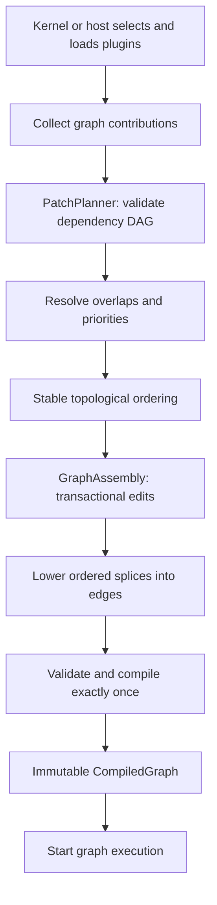

# Graph patch resolution — prototype algorithm

**Scope:** Graph assembly, compilation, execution. The patch planner has no
knowledge of plugins, agent harnesses, authentication or permissions. A future
plugin loader supplies contributors to `PatchPlanner`; an authority-owning
harness decides which contributions are admitted *before* graph construction.

**Implementation:** `src/authoring/patching.rs`, with external-crate tests in
`tests/patch_planner.rs`. Node/module implementation objects stay in Rust in this
prototype. The `PatchSpec` and `PatchTarget` metadata are a starting point for
future portable plugin contributions; `FnOnce` editing closures are **not** a
serialized cross-ABI patch format.

## Lifecycle



The loader is responsible for the origin and trust of contribution *code*.
`PatchPlanner` handles only graph-shape conflict and ordering. Existing graph
execution semantics do not change, and no patch callbacks run after `build()`.

## Declarative patch metadata and execution

```rust
let mut planner = PatchPlanner::new();
let mut patch = PatchBuilder::new("agent.model.override");
patch.after("agent.base").priority(50)
    .replace("model", custom_model);
planner.add_patch(patch)?;
let (artifact, resolution) = planner.build("agent")?;
let engine = Deployment::new(artifact.graph).build()?;
```

All plugin patches enter through `add_patch`. `GraphBuilder` is the shared
inner declaration vocabulary; there is no separate register-callback API.

## Algorithm and invariants

1. **Validate identities and prerequisites.** Each contributor has a unique
   symbolic ID, `after` dependencies, optional priority, and declared
   semantic write footprint. Reject missing dependencies and cycles. IDs never
   refer to flattened runtime `NodeId`/`EdgeId` values.
2. **Resolve independent conflicts.** Two contributions conflict if their
   write footprints intersect, excluding two *splices* on the same anchor.
   If one transitively depends on the other, layer them in dependency order.
   Otherwise both must declare different priorities; the higher priority wins.
   Equal or absent priorities fail closed. Superseded contributions are
   discarded as whole contributions; none of their edit closures is invoked.
   The greedy selection is done in descending priority, not plugin load order.
3. **Check superseded dependencies.** A selected patch requiring a discarded
   contribution is an error, not a silent fallback. Distinct independent
   contributions apply in stable lexical order after dependency constraints.
4. **Apply atomically.** Edit a clone of `GraphAssembly`. After each selected
   callback, compare the actual symbolic edit log to its declared footprint.
   Node behavior replacements, module rebindings, connection adds/removes,
   public-port additions and trigger additions are checked. Undeclared writes
   or callback errors discard the *whole plan's* in-memory edits. Callback
   external side effects cannot be rolled back and are outside this API's
   transactional guarantee.
5. **Lower noncommuting insertions.** A splice names an original edge and a
   new ordinary `T -> T` node. It declares a rational position strictly
   between 0 and 1, reduced to lowest terms and sorted exactly using `u128`
   cross products. Multiple splices on the same original edge are combined
   into one chain, regardless of registration order. Same-position splices
   require distinct explicit `splice_order` values; otherwise fail. A direct
   rewrite of that anchor edge competes with a splice, and needs an explicit
   winner or dependency. Generated edge rewiring is recorded as a separate
   assembler revision and contributor-specific splices appear in
   `PatchResolution.splices`.
6. **Compile once.** Graph construction expands module definitions, validates
   wiring, and creates an immutable executable graph. The planner does not
   modify live graph state or execution waves. Runtime waves start only after
   successful compilation.

## Worked ordered-splice example

Original `accept -> finish`:

```rust
let anchor = PatchAnchor::nodes("accept", "value", "finish", "run", "value");
let audit_patch = PatchBuilder::splice(
    PatchSpec::new("audit").after("base"), anchor.clone(),
    SplicePosition::new(1, 3)?, None, "audit_node", audit,
);
planner.add_patch(audit_patch)?;
let validation_patch = PatchBuilder::splice(
    PatchSpec::new("validation").after("base"), anchor,
    SplicePosition::new(2, 3)?, None, "validate_node", validate,
);
planner.add_patch(validation_patch)?;
```

Compiles to `accept -> audit_node -> validate_node -> finish`. The original
edge is removed once in the lowered transaction. Same-position insertions
require distinct explicit `splice_order` values.

## Tests

`tests/patch_planner.rs` includes: reversed-registration independence,
ordered-dependent overlays, priority winners and never-invoked losers, greedy
selection counterexample, tie/missing-priority rejection, missing/cyclic
prerequisite rejection, superseded prerequisite rejection, undeclared-write
and callback rollback, three-plugin graph creation/execution, compatible
module replacement, precise and broad edge claim conflicts, randomized
multi-module chains, one-shot build, commutative multi-splice composition,
position validation, anchor conflict and rollback, module-boundary splicing,
identifier and node/instance namespace collisions.

Existing `tests/assembly_cancel.rs` and `tests/assembly_model_checks.rs` cover
wave cancellation, cross-wave isolation, nested module behavior and loop
semantics. Run `cargo test -p phenix-graph --all-targets` with a Rust 2024-compatible toolchain.

## Explicit remaining limitations

- The plugin loader, contribution admission, provenance authentication and
  authorization are separate layers and **not implemented here**.
- A generic portable declarative edit serialization and pre-load validation
  are future builder/compiler work. Rust closures are not serializable.
- Splicing currently inserts one-port same-type `T -> T` *local nodes*;
  arbitrary multi-input or multi-output adapters require a richer edit IR.
- Patch footprints are supplied by contributors and cross-checked with
  implemented builder edit-log categories. They do not prove semantic
  commutativity of arbitrary function bodies. No solver can do that generally.
- Compilation failures are reported at `build`; already executed edit
  closures may have external side effects. Treat contributor callbacks as
  graph-only operations.
- Live mutation, patch rollbacks of executing generations, hot reload,
  resource or security policy changes, and formal temporal verification are
  deliberately outside this graph prototype.
