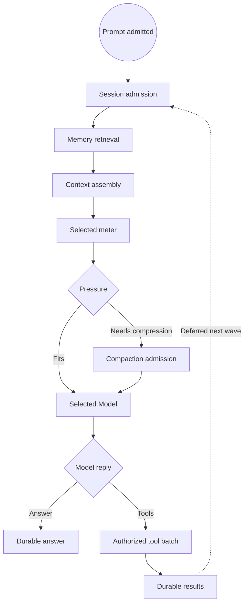

# Clean graph and plugin rewrite

Status: experimental rewrite branch, not P1 release evidence.
Reference: `reference/pre-clean-plugins-20261026` at `31f86f454fd4cd3316379b5802b02ba19ecae69c`.
Graph target: [v2.4](../spec/graph-architecture-v2.4.md). This is a design target, not an implemented runtime.
Progress: [rewrite log](clean-rewrite-progress.md).

## Purge boundary

Remove all `phenix-plugin-*` packages from this branch. Git retains their source at the pinned reference commit. Keep the proven ABI-3 kernel, portable Value/ValueSchema, selected operations, SDK and artifact validation as the starting point. Remaining libraries are available for evaluation, but are not automatically selected into the new product. This branch does not claim to ship P1, and must not replace `main` until parity is verified.

There is no graph-v1 compatibility promise for new plugin graph declarations. Do not add an adapter simply to let an old plugin survive the purge. Migrate one responsibility at a time to the latest accepted graph specification and remove retired integration code.

## Intended domain fragments

| Fragment | Domain owner | Typed entry | Typed result or authoritative effect | Verification |
| --- | --- | --- | --- | --- |
| Startup | Lifecycle manager | kernel Begin event | initialized owner state, ready event | registration order, all handlers settled |
| Provider definitions | Provider manager | populate event | owner-published catalog revision | duplicate/conflicting registration, no inferred auth |
| Authentication | Provider manager + strategy | AuthCommand | account-scoped AuthOutcome | PKCE/key checks, revocation, exact account |
| Model routing | Provider manager | SelectModel | pinned model binding | discovery vs implementation IDs, denied stale profile |
| Session | Session plugin | SubmitPrompt | scoped RunContext, journal sequence | auto-session, CAS, restart |
| Memory retrieval | Evidence owner + recall policy | RecallInput | verified RecallResult | source revision, scope, stale/withdrawn |
| Memory curation | Evidence owner + extractor | committed source event | CAS-published evidence revision | fabricated source, duplicate/restart |
| Context assembly | Agent | full session + recall + catalog | canonical ModelRequest | no hidden required-field defaults |
| Compaction | Checkpoint owner + policy | measured request + source | admitted measured request or typed denial | immutable source, CAS, exact remeasure |
| Model invocation | selected Model | complete ModelRequest | typed ModelReply | pending/cancel/account bindings |
| Tool routing | Tool manager | bounded ToolCallBatch | per-call ToolResultBatch | registered executor, IDs, partial failures |
| Agent loop | Agent | RunContext | answer/continue/stop | deferred waves, turn quota, no duplicate effect |
| Observation | Observer/Journaling owners | authorized stream/query | bounded progress, replay cursor | per-chunk grants and no secret leak |

These are *logical graph fragments*, not a mandate for one native crate per row. Shared domain managers own their live state. Concrete declaration plugins contain only registrations; algorithm plugins implement domain-specific operations. Policy and serialization live in shared Rust libraries when useful. Storage and journals remain durable domain services, not a general plugin state replacement.

## Planned graph connections

A one-wave `Flow` carries a typed value. `Order` never activates consumers. `Deferred::Next` crosses wave boundaries and is subject to bounded root quotas. Independent external auth and session triggers create independent authorized roots. Curation after a completed root needs a durable job and a new authorized root, or an explicit same-root event before root completion.

A summarizer never directly changes the canonical journal. A model-produced tool ID never selects an import slot. Neither dataflow nor a graph patch grants a new permission. Materialized source receipts and structured types are not substitutes for authorization, CAS, and meter checks.

## Target source layout

- `crates/phenix-contract/`: canonical portable types and graph-v2 IR.
- `crates/phenix-kernel/`: the sole graph compiler, scheduler, dispatcher, authority and generation manager.
- `crates/phenix-sdk/` and `crates/phenix-macros/`: generated typed declarations; no domain registry.
- `crates/phenix-basic-contracts/`: existing typed Model/Tools/Session compatibility baseline for small verification fixtures.
- `crates/phenix-plugin-model-fixture/` and `crates/phenix-plugin-tool-reverse/`: first small, credential-free test plugins. Neither is in a production composition.
- Future domain managers and policies are added only when a native graph composition can exercise them.

Prefer a few cohesive manager plugins with small contributions over one crate per graph node. Retain one canonical implementation of each mechanism.

## Migration and test gates

1. **Purge and baseline:** pinned reference branch, no old plugin crate present, small fixtures compile against SDK and public contracts. Only clean workspace Cargo tests count initially.
2. **V0/V1 graph compiler:** typed `Source -> Invoke -> Flow -> Invoke` including native pending/cancel and denied bindings. Follow v2.4 V0/V1.
3. **V2/V4 finite waves:** Switch/Merge/Join/Closed/Failed and bounded `Deferred::Next`; test arrival-order independence, authorization and physical draining.
4. **Basic parity:** minimal selected session, journal, tools, model, agent and frontend handlers. Compare a shared deterministic scenario corpus to the reference branch. No special graph runner in any plugin.
5. **P2 extensions:** independent memory retrieval/write, verified changed-candidate compaction, code intelligence, approval and durable jobs.
6. **Release gate:** default P1 prompt/auth/model selection/auto-session, restart, ACP and Neovim interoperability, exact-head Nix tests and an audited production closure. Only then replace or merge into `main`.

Every test is classified as **unit**, **contract/compile**, **native composed**, **product/frontend**, or **fault/restart**. A fake model must not replace session, journal, kernel, or authorization in a composition test. Record the exact tested commit and command, and distinguish pass, fail and not run.

## Logging discipline

Use the [rewrite log](clean-rewrite-progress.md) as the per-step ledger: reference and branch SHA, files removed/added, ownership decision, precise test command, results, blockers, and next dependency. Do not log success when a test was not run. Runtime trace events must carry generation, root/wave, selected operation, request digest and terminal reason with redaction; they must not contain credentials or confidential prompt bytes.
