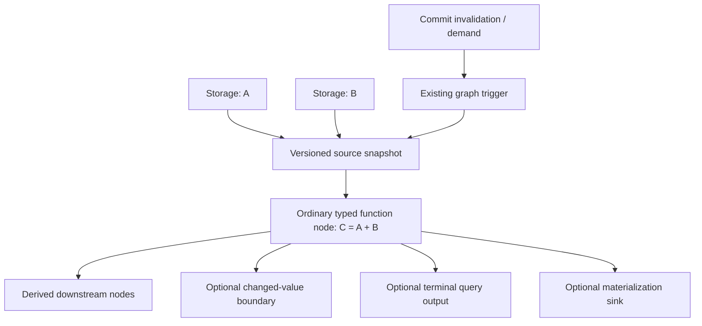
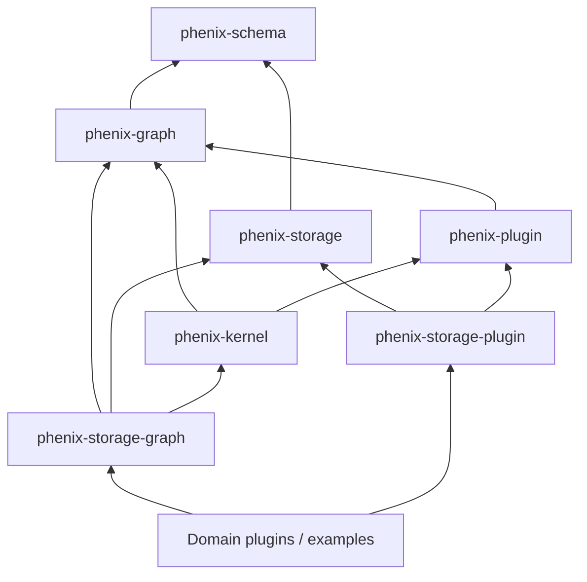

# Phenix — Graph-native derived values

**Status:** proposed implementation design, not implemented  
**Date:** 2026-11-08  
**Repository:** `matthis-k/phenix-ai`  
**Inspected implementation:** `impl/scoped-storage-resources-20261108` @ `86c29792f4f33eea58736a9c19d5f0a299fcc128` (base `rewrite/clean-foundation` @ `b53f5be1ca83a7208568e8d891eaa2e2b9ec30e5`)  
**Primary objective:** express `C = f(A, B)` with minimal author code, using the **existing graph compiler and wave executor** for reactive execution, while retaining storage consistency, access controls and independent plugin composition.

> **Decision:** do **not** implement another dependency scheduler, signal runtime, graph database, or hidden application-wide reactive context. Derived declarations are a *graph-authoring extension*. Source values live in Storage; dependencies become ordinary typed graph edges; invalidations become existing kernel producer events; caches are optional per-derivation runtime state.

---

## 1. Executive decision

A dependency DAG and an execution graph have similar edges but different semantics. `A + B` needs the **current** A and B, whereas Phenix's default multi-slot join accepts deliveries from the **same cohort**. A storage invalidation for A does not deliver B in that cohort. The correct initial lowering is therefore **one refresh source that reads all required stored inputs into one coherent bundle**, then ordinary graph computation nodes. The extension does not reinterpret `AllSameCohort` or turn Graph into a persistent data store.



The **source snapshot** and derived node are an ordinary graph submodule, expanded by the existing compiler. An external observer does not schedule graph actions itself; it submits a notice through the existing kernel `Producer` route. The graph's ordinary executor runs the wave.

### Selected behavior and non-goals

| Feature | V1 decision | Rationale |
|---|---|---|
| Reactive recomputation | Graph wave | Reuse existing triggers, scheduling, typed edges, fan-out and errors |
| `C = A+B` | Static source dependency declaration | Deterministic, analyzable, no hidden tracking |
| Lazy access | Explicit `query()` starts a demand wave | Do not introduce an independent evaluation engine |
| Latest value | Distinct `latest()` with explicit possible staleness; defer if unnecessary | Do not confuse cached and fresh reads |
| Memoization | Optional per-instance graph action | Reuse results by version; no second scheduler |
| Change suppression | Only at outward observer boundary | Internal joins still need value deliveries |
| Persistent materialization | Separate, later milestone with recovery metadata | Invalidations are not durable changefeeds |
| Dynamic read dependencies | Out of V1 scope | Would require runtime dependency tracking, closer to Salsa |
| General graph cycles | Remain supported | Reject cycles only within pure derivation declarations |
| Cross-backend atomicity | Explicitly unsupported | No distributed transaction protocol |

---

## 2. Existing repo: evidence and integration constraints

The following are **implemented facts**, verified by reading the repository at the inspected SHA, not assumptions about the planned API.

| Existing mechanism | Current implementation | Design consequence |
|---|---|---|
| Graph authoring | `GraphBuilder::node`, `connect`, `expose_input`, `expose_output`, `trigger`; typed `NodeHandle` | Derivation can add nodes and typed wires without graph-core dependencies on storage |
| Input admission | `AllSameCohort` requires same-cohort deliveries to all slots | Source refresh must deliver all required values in a wave; isolated A change cannot fulfill B |
| Graph values | Local Rust values (`TypeId`) or explicit `ContractValue` wire schemas | Local derivations are easy; cross-plugin wire contracts must remain explicit |
| Failure semantics | High-level `graph.node` treats `Result<T,E>` as a transported *value*; low-level `NodeAction::execute` returns `Result<Vec<Emission>, String>` as execution status | Fallible Storage source must use lower-level `NodeAction` or a verified `try_node` adapter; do not accidentally emit `Result` as success data |
| Wave outputs | `WaveReport::publications()`, terminal-only retention by default via `Deployment` | Query adapter must add a dedicated terminal tap or explicitly retain payloads; `expose_output` alone does not make a nonterminal output retained |
| Node instances | `NodeTemplate::with_action_factory` creates fresh state per physical instance | Memo state can live in action instance, not in Storage's registry |
| Graph state | Internal `Store` is runtime `Arc<Any>` resources; `InvocationCtx::read/write` | This is **not** persistent Phenix Storage and must not be confused with it |
| Storage | `Registry`, `Session`, `Backend`, `TypedKv`, `Sql`, `Subscription`; scope grants | Derivation reads through preauthorized Storage handles; never through a new bypass |
| Storage notifications | `Notice::{Changed,Overflow}`, bounded registry-local delivery, no durable cursor | Changes mean **revalidate**, not delta application; overflow demands a rescan |
| Storage graph bridge | `phenix-storage-graph::StorageBinding` implements kernel `Producer` | Extend this existing adapter rather than create a second event loop |
| Plugin composition | `phenix-plugin::Registrar`, snapshots, leased contributions; `phenix-kernel::Contribution` composes then activates producers | Derivation is an ordinary contribution; activation after graph compilation; retain provider lifetimes |
| Scoped storage (PR #1247) | `ResourceId`, `ResourceCatalog`, `Storage`, `Kv<T>`, `XdgPaths`, resource/backend offers | Bind user/project/session source handles once at plugin initialization |
| KV revisions / CAS | `Revision`, `Revisioned<T>`, `TypedKv::get_revisioned` and `compare_exchange` now exist in memory and SQLite, with regression tests | Reuse these; **do not** reimplement revision tokens or CAS |
| Multi-key coherent snapshot | No general atomic versioned `read_many` at the inspected SHA | New prerequisite for strongly consistent derived reads |

**CI update:** The earlier baseline run `42450640340` failed formatting. The later scoped-storage implementation commit `bcbad5edc751` passed hosted Flake CI run `42456482434`, as documented in `docs/scoped-storage-review.md`; the final docs-only head `86c29792` records that evidence. Recheck exact-head CI when implementing derived values.

---

## 3. Alternatives and tradeoffs

### A. Independent Salsa-style dependency engine

A dedicated query database would give excellent lazy memoized `get()`, red/green revision propagation, conditional dynamic dependencies and keyed queries. But it introduces another query/runtime, cache ownership, invalidation schedule, lifecycle and graph integration. It is attractive **later for evidence-based code intelligence with millions of dynamic symbol dependencies**, not for static configuration expressions.

### B. Pure direct graph wires from independent A/B change producers

Very little code, but **incorrect**: triggering A gives no same-cohort B delivery. Even if both A and B write in one SQL transaction, current notifications are not necessarily emitted as an atomic coherent pair. This approach cannot be the default.

### C. Existing graph with refresh/snapshot source + ordinary typed computation (**chosen**)

One source node reads all required current values in a grouped snapshot. The compute node is pure and can fan out to consumers. A commit or demand trigger starts the same graph wave. No new execution engine; a modest adapter and Storage batch-read capability suffice. Duplicate reads, coarse invalidation and explicit static dependencies are accepted for V1.

### D. Implicit reactive `derive(|| a.get()? + b.get()?)`

Excellent syntax but depends on runtime read interception/stack tracking and conditional dependency subscriptions. It would hide authority and scheduling in a context and substantially expand the runtime. Optional later, **not foundational**.

### E. Compiler-recognized special `DerivedNode`

Would complicate the Graph engine with caching, Storage access, and observation rules not needed by ordinary graph nodes. Instead compile a reusable **module made of existing nodes**.

**Selected:** C. Keep the native graph as the only scheduler. Explicit dependencies and optional caching. Do not adopt `salsa`, `leptos`, or `bevy` as runtime dependencies.

---

## 4. Desired author API

### 4.1 Declare resources once

Target API in this section is **proposed**. `CellSpec<T>` and `ReadCell<T>` are not currently present in PR #1247; its `Kv<T>` requires string keys. A singleton cell is a small typed view over an existing KV dataset/key, **not** a new backend or physical resource.

```rust
const A: CellSpec<i64> = CellSpec::project_state("demo.values/a");
const B: CellSpec<i64> = CellSpec::project_state("demo.values/b");

// Plugin initialization, after trusted host resource planning:
let (a, b) = cx.bind((A.read(), B.read()))?;
```

### 4.2 Derive and wire — canonical macro-free form

The external extension trait is implemented for `GraphBuilder`, while tuple input traits are implemented inside the integration crate for supported arities (start with 1–4; an internal `macro_rules!` to generate repetitive tuple impls is acceptable). The closure remains an ordinary `Fn` and should infer argument and output types. Do **not** add a graph-core `derive` method or require a procedural macro.


```rust
use phenix_storage_graph::derived::GraphDeriveExt;

let sum = graph.derive("sum", (&a, &b), |a, b| a + b)?;
let twice = graph.derive("twice", (&sum,), |sum| sum * 2)?;

graph.connect(twice.output(), consumer.inlet())?;
```

Assume the sample types implement the shared `Stored`/codec contract; the extension does not invent a codec for `i64`. The returned `DerivedRef<T>` is a **typed graph-authoring handle**, not a database handle. It has an output endpoint. A derived node may take other derivations as inputs. The extension records its source requirements as part of ordinary graph authoring; graph compilation checks the final physical connections.

### 4.3 Explicit request for active updates

```rust
// Compose/activate a storage observer for sum's source dependencies.
sum.observe(&mut contributions)?;

// Graph already knows which downstream consumer should run.
graph.connect(sum.output(), consumer.inlet())?;
```

`observe()` here is a high-level **composition request**; implementation may prefer `derived.observe(&sum)` on a plugin-owned builder to avoid coupling the authoring handle to plugin registration. Choose one and document why. It must not start a subscription during graph construction. Observers are activated after compilation and when the host starts the kernel.

### 4.4 On-demand query: no hidden second executor

```rust
// External host code after compilation/start, not called recursively inside a node:
let query = runtime.bind_query(sum)?;
let current: i64 = query.query()?; // fires an ordinary demand wave
```

`query()` re-evaluates from a coherent source snapshot taken during that wave, and returns the validated terminal publication from that same wave. A concurrent commit after the snapshot may occur before `query()` returns: this is a snapshot read, not a claim that the result is the latest wall-clock value at return time. Do not imply it is a cheap direct `get()`. In graph node domain logic, prefer `sum.output()` and an edge instead of nested `query()`.

**Important:** a `DerivedRef<T>` created during authoring must not hold `&GraphBuilder` or runtime `Engine`. Runtime query binding must establish that the handle belongs to the compiled graph/generation and pin its lifetime.

### 4.5 Optional policies, introduced only after the core works

```rust
let sum = graph.derive("sum", (&a, &b), |a, b| a + b)?;
let sum = sum.memoize_by_revision()?;      // optional, same module/output interface
let changed = sum.changes();              // only sends when output differs
let persisted = sum.materialize(C.write()); // separate explicit sink
```

The first implementation should target `derive`, `output`, `observe` and demand `query`. Do not implement every convenience method before validating the execution semantics.

### 4.6 Missing values and errors

Default derivations require all inputs. A missing source results in a **typed source-unavailable error**, not an implicit zero, `None` emission, or permanently waiting graph join.

```rust
let sum = graph.derive("sum", (&a.optional(), &b), |a, b| {
    a.unwrap_or(0) + b
})?;
```

Authoring-time `.optional()` is a type/absence policy. Storage/codec failures and access denial are errors, not ordinary missing values.

---

## 5. Crate dependency design

### 5.1 Do **not** introduce a new foundation crate initially

The current workspace already has the right integration point:



**Add an optional `derived` module to `packages/phenix-storage-graph`**. It already depends on Graph, Storage and Kernel, so the functionality can be delivered without any foundational dependency changes. The kernel need not depend on Storage. Graph need not depend on Storage. Plugin registry need not depend on derivation code.

Initial module organization:

```text
packages/
  phenix-storage/
    src/lib.rs                  # existing backend/registry/Revision/CAS
    src/scoped.rs               # existing scoped resource views (PR #1247)
    src/snapshot.rs             # new same-mount coherent batch reads
  phenix-storage-graph/
    src/lib.rs                  # existing StorageBinding producer
    src/derived/mod.rs          # public GraphDeriveExt, DerivedRef<T>
    src/derived/inputs.rs       # static input tuples and type erasure boundary
    src/derived/lowering.rs     # actual GraphBuilder node/edge construction
    src/derived/source.rs       # fallible read/refresh node action
    src/derived/producer.rs     # observation-to-refresh producer adapter
    src/derived/query.rs        # demand route, terminal output validation
    src/derived/memo.rs         # optional, later milestone
    tests/derived.rs            # full graph/storage integration tests
  phenix-storage-plugin/
    src/lib.rs                  # existing resource/backend offers, host preflight
```

Keep these as **modules**, not new crates, unless tests/build evidence shows an independently reusable API boundary. If `derived` later needs to be used without Kernel, extract a `phenix-derived` crate that depends only on `phenix-graph` and `phenix-storage`, and keep a tiny `phenix-derived-kernel` adapter in `phenix-storage-graph`. Avoid that split up front.

### 5.2 New third-party dependencies

**None required** for V1. Use existing `std`, `rusqlite`, typed graph facilities, schema and plugin APIs. Do not add Salsa, Tokio, Bevy or Leptos just to get reactive values. A procedural macro may be added later solely to reduce tuple/input boilerplate; no macro is required for core functionality.

### 5.3 Internal ownership table

| Type / module | Owns | Must not own |
|---|---|---|
| `CellSpec<T>` / bound `ReadCell<T>` | Typed logical resource and authorized Storage handle | DB instance, filesystem path, scheduler |
| `SnapshotReader` | Coherent same-mount read of requested source keys | Graph events or derivation logic |
| `GraphDeriveExt` | Declarative lowering into GraphBuilder | Graph runtime |
| `DerivedRef<T>` | Named typed output + demand trigger metadata | Mutable computed cache; backend authority |
| `ReadSourceAction` | Read all required inputs on one refresh, emit typed bundle or error | Subscription lifecycle |
| `FunctionNode` | Transform typed values in an ordinary graph wave | Storage handles unless explicitly captured |
| `DerivedChangeProducer` | Own subscription(s); map invalidation/overflow to refresh notice | Compute or retain derived value |
| `MemoAction` (later) | Cache result + input revisions per physical node instance | Global cache, cross-process guarantees |
| `QueryHandle<T>` | Validated runtime trigger, terminal output selector, generation lease | Nested execution from graph node |
| `MaterializationSink` (later) | Output persistence with revision checks and recovery metadata | Background scheduler independent of Kernel |

---

## 6. Lowering algorithm: exact graph behavior

### 6.1 Single derivation

Given `graph.derive("sum", (&a, &b), |a,b| a+b)`:

1. The authoring extension checks stable names, read capability declarations, codec/type compatibility and dependency shapes. It does **not** read Storage or activate observers.
2. Create a `Refresh` public input with a single typed payload `RefreshCause` (one ingress per wave).
3. Create **one fallible `ReadSourceAction`** that accepts `RefreshCause`, performs one grouped Storage read for A and B, and emits a local typed tuple `(A, B)`.
4. Create an ordinary local computation node taking `(A, B)` and producing `C`. Use an atomic tuple input in V1; no named multi-slot policy is necessary. Optional `Layout::fields()` can improve inspection later.
5. `graph.connect(read.output(), calculate.inlet())` using existing typed endpoints.
6. Expose calculation output for downstream graph composition. Expose a separate terminal output tap for `QueryHandle<T>` when needed.
7. Create/validate one public trigger route to the `Refresh` inlet. A typed `DerivedRef<C>` references the compute output and route descriptors, never a second execution graph.
8. On deployment, activate authorized source observers; on relevant notice, the producer submits the same refresh trigger. The graph executes the exact same read/compute chain for explicit queries.

**No per-input trigger joins.** A storage notice for A or B means *refresh the whole read-group*, not "deliver A into C's slot." This is how the semantics differ from ordinary dataflow edges.

### 6.2 Composition and fan-out

`D = 2*C` is an ordinary `graph.connect(C.output(), D.inlet())`. Existing graph fan-out, type checks and cohort propagation are preserved. For a diamond `D = C*2`, `E = C+D`, ensure C and D arrive in the same wave/cohort before the normal join. Never emit a value along only one required dependency edge in that wave.

If a derivation has independently observable sources, the extension must provide **one coherent refresh root** for all required leaf sources in that derived subgraph. It can initially lower a derivation root into a source-read group and its dependent compute chain. Do not casually create separate producer waves for each leaf. Construction-time dedup of overlapping source groups is an optimization, not a correctness prerequisite; see limitations below.

### 6.3 Multiple derivation roots — V1 constraint

For `C = A+B` and `D = C*2`, D **inherits C's refresh root**. A demand query of D fires that root and selects D's terminal publication. There is no independent wave just for D. If D also needs a new stored leaf not included in the inherited source group, V1 rejects it until a *unified source group* is explicitly declared. Cross-root source-group merging, overlapping subscriptions and source-read dedup are optional later improvements. Document possible redundant source reads across unrelated roots; each individual wave remains internally consistent within its declared read group.

### 6.4 Multiple refresh roots and typed input constraints

**V1 root rule:** Every derivation subgraph has exactly one refresh root/source group. A derivation of only stored inputs creates a new source group. A derivation of already-derived values **inherits** their source group. Mixing values from distinct refresh roots in one derived expression must fail at authoring with `MultipleRefreshRoots`, **unless** the caller explicitly constructs a new unified source group that reads all transitive stored leaves together. Do not start two independent waves and hope `AllSameCohort` will pair them. This restriction is preferable to silently returning stale or incomplete results.

Examples:

```rust
let c = graph.derive("c", (&a, &b), |a, b| a + b)?; // root R1
let d = graph.derive("d", (&c,), |c| c * 2)?;       // inherits R1
let e = graph.derive("e", (&c, &d), |c, d| c + d)?; // same R1: valid diamond

let other = graph.derive("other", (&x,), |x| x * 3)?; // root R2
// graph.derive("bad", (&c, &other), |c, o| c + o)?;
// Error: MultipleRefreshRoots(R1, R2); must explicitly regroup source leaves.
```

`DerivedRef<T>` needs a small authoring-only `SourceGroupId`/root descriptor to verify this; **not** a secondary runtime or mutable dependency tracker. An explicit regrouping operation can be designed after the initial same-root prototype. Querying `d` or `e` fires their inherited R1 refresh trigger and reads their own output publication, not an independent wave for each intermediate input.

The current high-level `GraphBuilder::node` local closure path expects its atomic input to be `Clone + Send + Sync`. V1 may document and enforce these bounds for source tuples. For large/non-`Clone` inputs, prefer owned lower-level local actions or `Arc<T>` as the conveyed value; do not hide an unconditional deep clone inside `derive`.

### 6.5 Cycles

Pure derivations form a DAG; reject a cycle in derived declarations during authoring/compilation with the specific path causing it. **Do not reject cycles in the general Phenix Graph**, which intentionally supports loops and custom policies.

---

## 7. Storage prerequisite: versioned, coherent batch reads

Current Storage **does** expose versioned single-key reads (`get_revisioned`) and atomic compare-exchange, but does **not** expose a coherent multi-key snapshot. Calling individual reads multiple times does **not** provide a promised atomic cross-key snapshot, particularly with independent SQLite connections. Calling `Session::get` recursively inside `Session::transaction` on the same mount is not a solution: the implementation detects same-mount reentry.

### 7.1 Proposed minimal low-level API (additive to existing `Revisioned<T>` and CAS)

```rust
pub struct ReadKey<'a> {
    pub dataset: &'a str,
    pub key: &'a str,
}

pub struct SnapshotEntry {
    pub value: Option<Revisioned<Vec<u8>>>, // use existing Revisioned<T>
    // Absence may need a separate backend-specific change token when caching.
}

pub enum ReadConsistency {
    AtomicWithinMount,
    BestEffort,
}

pub trait TypedKv: Send {
    // Existing get / put / delete remain supported.
    fn read_many(&mut self, keys: &[ReadKey<'_>])
        -> Result<Vec<SnapshotEntry>>;
}
```

The exact borrowed/owned representation can change, but **batch membership, ordering, absence and revision identity are mandatory**. A backend must advertise whether `read_many` gives a true atomic snapshot. Do not default a non-atomic loop of gets to an `AtomicWithinMount` capability.

Memory: one per-mount lock over batch + **existing** revision tracking. SQLite: one read transaction for all requested keys with consistent transaction snapshot + **existing** persisted revisions. Do not rely on a process-local invalidation sequence as a durable revision. For missing keys, decide how a cached computation knows absence has remained unchanged; simply using `None` for every absence is insufficient for robust revision memoization. Carry the backend's own snapshot identity where appropriate.

**Before use**, the Storage layer must authorize *each* source dataset/key request and validate its schema/codec contract. Never let a batch API bypass grants because it is called from a trusted adapter. Bound source handles may prevalidate immutable authority, but revocation semantics must remain explicit.

### 7.2 Cell keys and source grouping

A singleton `CellSpec<T>` is a typed view over one logical KV resource and one reserved, internal *key* (for example `"value"`) selected by the adapter. Two cell specs with different resource names must not alias one physical key accidentally. The descriptor is resolved and authorized at initialization; `.get()` never rebuilds its address. A `ReadSourceAction` groups its bound cell keys by physical mount and calls the authorized `read_many` once; the original input ordering and each source's revision/absence must be preserved when decoding the typed tuple.

### 7.3 Scope of atomicity

- Same backend/mount with proven atomic batch capability: guaranteed consistent source values for one refresh.
- Cross-mount/project/user mix: not atomic. **Default reject if strong consistency is requested**. Permit an explicit `best_effort()` option if the consumer accepts skew.
- Cross-process external SQLite writers: the batch transaction must use SQLite's own snapshot guarantee, not merely Rust's per-mount lock.
- Missing values: return a typed absence result; the derivation's explicit `required`/`optional` policy decides what to do.

### 7.4 First prototype without batch reads

If batch snapshots are not yet implemented, one **explicitly labeled best-effort** prototype can use sequential `ReadCell::get()`, but it must not be called strongly consistent or be used for authorization/security decisions. The acceptance version must use verified same-mount snapshots or document a deliberately weaker API contract.

### 7.5 Revisions, publication and invalidation

Versioned KV/CAS is **already implemented for built-in memory and SQLite**. Memoization must consume that existing API. Revision IDs must be scoped to the physical dataset/key namespace and survive SQLite reopen. A deletion/recreation cannot reuse a stale revision (ABA). A committed batch with A/B changes may generate more than one bounded notice: semantics require **revalidation**, not exactly one recomputation per SQL transaction. Coalescing may reduce redundant waves but must never drop the only invalidation.

---

## 8. Runtime refresh / query semantics

### 8.1 `RefreshCause`

```rust
pub enum RefreshCause {
    Demand,
    Invalidated(phenix_storage::Notice),
    Resynchronize,
}
```

Source node logic treats all variants as requests to **read current source values**, not to apply a delta. `Overflow` and `Resynchronize` mandate a full read. A notice's sequence is diagnostic, **not** a proof that it contains current values or a transaction snapshot.

### 8.2 Storage producer integration

Today `StorageBinding` maps one `Subscription` notice to `Value::local(Notice)` and one declared trigger name. Extend it with a small **typed notice mapping adapter** or a dedicated wrapper that preserves subscription ownership, wake registration, nonblocking polling and bounded overflow semantics. It must not duplicate the polling scheduler or wake mechanism. Producer routes must be declared and preflight-checked by the existing Kernel.

### 8.3 Query binding and terminal results

`QueryHandle<C>` is bound after graph compilation to:

- an exact generation/engine identity,
- a validated demand trigger,
- a specific terminal output address and local/wire type,
- the authorized storage/source lifetimes required for that generation.

`query()` fires a single demand wave **outside the graph node execution context**, checks `WaveReport::success()`, and extracts **one** expected terminal `PublicationRef` matching output address/cohort. Return a structured error if the wave failed or zero/multiple unexpected values were emitted. A demand query should not accidentally return an earlier cached publication.

Because deployment normally retains terminal outputs only, the derivation compiler must create a terminal *tap* node if its compute output also fans out to consumers; merely `expose_output()` is not sufficient. Alternatively, explicitly configure retained payloads for query deployments and justify the memory cost. Prefer a tap in V1.

`latest()` is optional and explicitly stale; if implemented later, it is a separate cache read with freshness metadata, **never an alias for `query()`**.

### 8.4 Errors

- Missing required source: a typed `MissingInput` error.
- Missing permission: `Denied` from Storage, propagated as graph node failure.
- Incompatible schema/codec: fail before activation when possible; runtime failure if a provider changes contract.
- SQLite/codec/read failure: node action returns execution error, not successful `Result<...>` payload.
- Existing `NodeAction::execute` uses `Result<..., String>`, so typed Storage errors necessarily cross a string-based graph diagnostic boundary today. Retain structured `DerivedError` for host-side binding/query/preflight and encode a stable error category in the graph diagnostic. Do **not** claim the current `WaveReport` exposes a typed Storage error; adding such support would be a separate graph-core proposal.
- Graph admission error and node execution error remain distinct.
- After a failed refresh, retain old `latest()` only if explicitly marked stale; never present it as fresh.

---

## 9. Memoization and output-change suppression (phase 2)

### 9.1 Revision-based memo

A memoized `FunctionNode` stores per-physical-instance:

```rust
struct Memo<T> {
    result: Option<T>,
    source_revisions: Vec<Revision>,
    last_successful_generation: u64,
}
```

On a wave: read the coherent source group; if all relevant input revisions match, reuse the cached result; otherwise compute and update the memo only after a successful computation. State must be owned by an instance produced by `NodeTemplate::with_action_factory`, with concurrency/locking consistent with the chosen executor. Never share memo state between differently configured module instances unless explicitly requested.

### 9.2 Internal delivery must continue

**Critical:** even when the memo returns an unchanged cached value, it must still emit that value to **all required internal graph edges in this wave**. If `C` stops emitting, `D` or a downstream `AllSameCohort` join may never become ready. Therefore:

- `memoize()` = avoid recomputation, still fulfill internal dependencies.
- `changes()` = separate **outward-facing optional notification/sink boundary**; suppress externally observable update when equal.
- `updates()` = outward-facing boundary that emits for every successful refresh.

The equality policy for `changes()` must be explicit (`PartialEq` by default where available, custom comparator otherwise). Do not force arbitrary types to implement equality merely to be used as derived values. Do not interpret `Result` as equality.

### 9.3 Avoid global recomputation guarantees

One wave may be triggered per registry notice. `a` and `b` changed in one transaction may cause two invalidations. V1 may recompute twice. Memo/revision check and coalescing may reduce that, but don't promise exactly-once delivery until the source supports commit-level change grouping.

---

## 10. Materialized results (phase 3, opt-in)

```rust
let derived = graph.derive("sum", (&a, &b), |a, b| a + b)?;
materialize(&derived, C.write(), MaterializePolicy::Revalidate)?;
```

Materialization is an **effectful graph sink**, not a new kind of stored dependency. It needs provenance/revision metadata: `{ output, source_ids, source_revisions, algorithm_version }`. A source change requires recomputation. Before a sink commits, revalidate that its source revision tuple is still current; if not, retry through a new wave or mark stale. Never overwrite newer C with the result of an earlier, slower wave.

**Guarantee levels:**

1. V1: no persistent materialization.
2. Best-effort: graph emits and sink writes, but after crash/overflow C may be stale; mark as such and perform startup reconciliation.
3. Recoverable: persist source revision watermark and reconcile on restart, overflow, plugin reload and schema migration. Same-backend atomic write+metadata is desirable. Cross-mount writes remain eventually consistent.

Do not claim durable correctness based solely on current bounded in-process `Subscription`. A durable change log and cross-process observation would require separate backend capabilities, not implementation inside Graph.

---

## 11. Plugin composition, lifecycle and shared contracts

### 11.1 Composition ordering

1. Host loads plugin set and collects `ResourceOffer`/`BackendOffer` declarations.
2. Host resolves scope templates to concrete user/project/session IDs; chooses mounts, verifies schema and read/subscribe grants; provisions Storage and creates restricted `ReadCell<T>` handles.
3. Domain plugin contributions construct graph nodes through `GraphDeriveExt` using those already-bound handles; graph compiler validates typed connections and derived module interfaces.
4. Kernel validates producer routes, builds deployment and captures plugin/provider leases.
5. Kernel `start` activates subscriptions. The initial refresh is an explicit demand/bootstrap wave **after** observation readiness, with a rescan strategy for races.
6. Observers submit refresh causes through existing `Producer`/`StorageBinding` adapter; graph runs normal waves.
7. On unload/reload: stop producers before dropping graph/deployment resources; retain exact plugin revision and backend leases until no active generation uses them.

**Startup race rule:** a simple read-then-subscribe can miss writes. Subscribe-before-read plus a post-read recheck may be sufficient for registry-local writers if the backend exposes a coherent watermark; otherwise document the weaker guarantee and periodically resync. Do not silently claim gap-free startup or process-crossing event delivery.

### 11.2 Cross-plugin derivations

A can define the shared `CellSpec<T>` descriptor and B may independently define a matching schema; Storage resolves by canonical resource identity and encoding contract. But **graph local typed endpoints remain Rust `TypeId` based**: unrelated Rust types in different crates cannot be wired as local values merely because their fields look alike. For cross-plugin graph outputs, require the existing `ContractValue` wire contract and `InterfaceBounds`, or a conversion adapter at an explicit boundary. Do not invent a new contract system.

### 11.3 Permissions

The new API **does not grant** storage access. `graph.derive` consumes already authorized read handles; observations require subscribe grants; materialization requires write grants. Declarations and plugin provenance are not security capabilities. Arbitrary in-process Rust plugin code is not sandboxed; the Storage API grant model does not make an untrusted native plugin process-safe.

---

## 12. Macro-level integration and exact change inventory

### No changes in first pass

- `phenix-graph` scheduler, node policies, coloring, edge routing and compilation invariants.
- `phenix-kernel` run loop, producer scheduling, plugin manager.
- `phenix-plugin` contribution registry.
- `phenix-schema` canonical shared schema format.

### Minimum code changes

| File / crate | Change | Priority |
|---|---|---|
| `packages/phenix-storage/src/lib.rs` | Reuse existing opaque `Revision`, `Revisioned` and CAS; avoid a duplicate versioning implementation | Already implemented |
| `packages/phenix-storage/src/snapshot.rs` | Auth-checked same-mount `read_many` with explicit atomic capability | Prerequisite |
| `packages/phenix-storage/src/lib.rs` | Add and wire **coherent multi-key batch-read** capability using existing revisions and MemoryBackend/SqliteBackend; preserve old API | Prerequisite |
| `packages/phenix-storage/src/scoped.rs` | Minimal `CellSpec<T>`, `ReadCell<T>` over existing KV resource/key; pre-bind capabilities and schemas | Prerequisite |
| `packages/phenix-storage-graph/src/derived/mod.rs` | `GraphDeriveExt`, `DerivedRef<T>` and tuple-input implementations | V1 |
| `.../derived/lowering.rs` | Typed source node, compute node, graph connections and demand trigger | V1 |
| `.../derived/source.rs` | Fallible source action with batch read, typed source errors, source snapshots | V1 |
| `.../derived/producer.rs` | Map authorized Storage notices to refresh causes using existing producer lifecycle | V1 |
| `.../derived/query.rs` | Dedicated terminal tap and typed wave-publication extractor | V1 |
| `packages/phenix-storage-graph/tests/derived.rs` | Full integration and failure tests | V1 |
| `packages/phenix-storage-graph/src/derived/memo.rs` | Optional action-local memo and change boundary | V2 |
| `docs/derived-values-design.md` | This spec, update as behavior changes | V1 |
| `flake.nix` / CI checks | Ensure derived storage integration tests are covered by the existing `integration` check | V1 |

Use the smallest change that fulfills each item. If storage snapshot support already appears in the branch by implementation time, adopt it rather than reimplementing it.

---

## 13. Test matrix and acceptance criteria

Each mechanism needs an isolated test and at least one end-to-end graph test. Negative paths must verify failure isolation, not only the expected error.

### 13.1 Semantics

| Test | Expected |
|---|---|
| A=3, B=5, demand C | C=8 through terminal publication |
| Change A to 4; B unchanged | C=9, no stuck `AllSameCohort` join |
| Change B only | Correct recomputation |
| C=A+B; D=C*2 | One wave reaches D with correct value |
| Diamond E=C+D | Both inputs same cohort; graph accepts join |
| Fan-out C to multiple consumers | All receive typed value |
| No observer requested | No extra producer installed; demand query still works |
| Missing required A | Structured wave error; no output; later successful wave unaffected |
| Optional A absent | Explicit fallback honored |
| Codec error or denied read | Error propagated as graph node failure, not `Result` payload |
| Derived cycle | Derivation compile rejects; general graph loop tests still pass |

### 13.2 Storage and consistency

| Test | Expected |
|---|---|
| Atomic batch A/B same memory mount | No mixed snapshots |
| Atomic batch A/B same SQLite mount | No mixed snapshots, including external concurrent writer |
| Cross-mount request requiring atomicity | Preflight rejected |
| Cross-mount `best_effort()` | Works and visibly reports weaker guarantee |
| Two updates inside one committed transaction | No partial-state output |
| Uncommitted transaction rollback | No accepted changed-state output |
| Watch overflow | Full rescan; graph recovers |
| Subscribe/start race | No lost required refresh under advertised coverage; otherwise explicit weaker contract |
| Plugin grant without subscribe authority | No observer activated |
| Plugin grant without read authority | Source cannot run |
| Project P and project Q | Separate scoped resources and graph handles |

### 13.3 Memo and lifecycle (when enabled)

| Test | Expected |
|---|---|
| Same revisions queried twice | Compute closure runs once with memo enabled |
| Revision changes but equal output | Internal edges still get delivery; external `.changes()` doesn't |
| Downstream join with memoized unchanged input | No deadlock or missing required input |
| Cancel/reload graph generation | Old instance state and observers released; leases retained until safe |
| Two module instances of same derivation | No accidental shared mutable memo state |
| Failure in one wave | Later independent wave succeeds; no poisoned cache |
| Materialization before source update (later) | Revision checked; older result never overwrites newer result |

### 13.4 Verification commands

```bash
cargo fmt --all --check
cargo test --workspace --locked
cargo test --workspace --no-default-features --locked
cargo clippy --workspace --all-targets --locked -- -D warnings
nix flake check --no-update-lock-file --print-build-logs
```

Preserve existing graph conformance cases, especially skipped branches, policy settlements, cycles, wave errors, independent cohorts and cancellation.

### Acceptance for V1

- The canonical `graph.derive("sum", (&a,&b), |a,b|a+b)` API compiles and uses ordinary Graph nodes.
- A/B changes trigger **one new graph wave per admitted refresh notice**, with current values fetched as a group.
- On-demand demand wave returns the current C without a hidden second executor.
- Correct behavior for chain and diamond is proven in integration tests.
- No graph-core storage dependency, no kernel modification, no separate scheduler.
- Atomic same-mount sources use genuinely atomic snapshots; any best-effort mode is explicitly requested.
- Unauthorized operations fail with typed Storage/host errors at their native boundary; runtime graph failures are classified diagnostics under the current string-based `NodeAction` API.
- Format, Cargo tests, Clippy and Nix checks pass.

### Acceptance for V2 (separate later PR)

- Revision-based memoization, equality-based outward change suppression and no incomplete internal joins.
- Distinct update/change/memo semantics and tests.

### Acceptance for V3 (separate later PR)

- Persisted derived values have source revision metadata, stale-output prevention, overflow/startup recovery and explicit durability/consistency guarantees.

---

## 14. Risks and deliberately deferred topics

1. **Freshness vs latest value:** do not quietly return last observation as current storage state.
2. **Graph node fallibility:** `Result<T,E>` from normal `graph.node` is a value; use `NodeAction` error semantics or a tested adapter.
3. **Batch snapshot/read consistency:** current storage API does not guarantee it. This is a real prerequisite.
4. **Query terminality:** default `TerminalOutputs` retention cannot read nonterminal compute publications without a tap.
5. **Shared source fanout:** V1 may recompute/read more often than ideal; optimize after correctness and profiling.
6. **Cohort joins and memo suppression:** do not skip internal deliveries when memo result is unchanged.
7. **Dynamic indexed dependencies:** code intelligence facts often depend on runtime-discovered symbols; store those relations and use a dedicated optional incremental-query capability if justified, rather than one static node per symbol.
8. **Multi-backend consistency:** cannot silently supply an atomic snapshot for a user config and project data on independent database mounts.
9. **Plugin lifetime and security:** provider leases and grants must survive into active runtime; code-level plugin identity is not authorization.
10. **Materialized output correctness:** durable replay and recovery are separate capabilities and must not be inferred from current registry-local invalidation queues.

---

## 15. Research informing the design

These are **reference patterns**, not selected runtime dependencies:

- **Salsa red/green incremental queries:** revisions, dependency tracking, backdating unchanged results and lazy memo validation. Useful later for dynamic code-intelligence queries, but a distinct runtime is excessive for static graph derivations. https://github.com/salsa-rs/salsa/blob/master/book/src/reference/algorithm.md and https://docs.rs/salsa/latest/salsa/
- **Leptos derived signals and Memo:** separate cheap derived reads from memoized computations, and distinguish reactive effects from pure transformations. https://docs.rs/leptos/latest/leptos/prelude/struct.Memo.html and https://docs.rs/leptos/latest/leptos/reactive/index.html
- **Bevy change detection:** mutation/changed ticks and conditional scheduling; illustrates the difference between detecting a mutation and comparing value equality. https://docs.rs/bevy/latest/bevy/ecs/change_detection/
- **SpacetimeDB subscriptions:** initial state plus subsequent deltas is a stronger explicit protocol than Phenix's registry-local invalidations. https://spacetimedb.com/docs/clients/subscriptions/
- **Materialize views:** separates recomputed views, in-memory indexed views and durable materialized views. This justifies keeping materialization an opt-in phase. https://materialize.com/docs/fundamentals/concepts/views/
- **Phenix source of truth:** `packages/phenix-graphs/src/authoring.rs`, `packages/phenix-graphs/src/lib.rs`, `packages/phenix-graphs/src/deployment.rs`, `packages/phenix-storage/src/lib.rs`, `packages/phenix-storage-graph/src/lib.rs`, `packages/phenix-kernel/src/lib.rs`, and `packages/phenix-plugins/src/manager.rs` at the inspected SHA.

---

## 16. Implementation sequence for an agent

**PR A — foundational correctness**

1. Fetch latest PR #1247 head and CI; fix or isolate preexisting failures. Do not redo already-implemented CAS.
2. Reuse versioned KV and implement the missing same-mount coherent `read_many` capability with negative tests.
3. Add `CellSpec<T>`/`ReadCell<T>` singleton view over existing bound KV, without new backend.
4. Verify permissions, scope separation and SQL/Storage reentrancy constraints.

**PR B — graph-native derived V1**

1. Add `derived` module to `phenix-storage-graph` with macro-free typed authoring API.
2. Lower a single derivation to one fallible grouped-read source node plus one ordinary compute node.
3. Add explicit demand trigger and terminal output tap; implement `QueryHandle<T>::query()` via existing Engine wave.
4. Adapt `StorageBinding` notices to `RefreshCause`, activating only after kernel graph compile.
5. Implement chain, diamond, failure isolation, overflow and cross-plugin tests.
6. Run full Cargo/Nix CI; review for any second scheduling/caching subsystem and remove it.

**PR C — optional performance and persistence**

1. Add action-local revision memoization, validating no skipped internal deliveries.
2. Add equality-filtered *outward* `.changes()` boundary.
3. Only after durable change/recovery requirements are defined, add materialization with source revisions and revalidation.

**Final architectural acceptance:** Graph continues to own execution, Storage owns persisted state and snapshots, Plugin contributions own domain declaration/behavior, and Kernel only composes and runs them. The public API remains concise because expensive validation and wiring happens at initialization, not on every node invocation.