# Phenix Graph Architecture v2.4 — Typed Dataflow, Finite-Wave Semantics and Deterministic Graph Patches

**Status:** Latest graph-v2 design proposal for review; not implemented on `main`. This file defines intended future semantics, not an as-built API. Current behavior is determined by source and tests at the inspected commit. Earlier graph RFCs are historical when they disagree with this proposal. Incorporates the v2.1/v2.2 counterexample review, agent-harness ownership review, and the ten-point v2.3 contract review (25 October 2026).  
**Scope:** M1 Phenix kernel, graph metadata, contract SDK, resolver and native plugin authoring.  
**Baseline inspected:** `matthis-k/phenix-ai` current `main` graph declarations/compiler, `phenix-contract` portable values and `Operation`, `phenix-kernel` `Prepared`/`GraphExecution`, ABI 3, and the event-driven draft implementation stack through #1153 (25 October 2026).

## 0. Decisions at a glance

| ID | Decision | Why |
|---|---|---|
| D01 | One immutable compiled graph can contain disconnected dataflow components and any number of independent trigger sources | Plugins describe capabilities without globally agreeing on one workflow |
| D02 | Nodes expose typed ports; data edges carry `Value`s or checked references | Results can flow from operations to consumers without redundant plugin-held temporary state |
| D03 | Distinguish **Flow**, **Order** and **Deferred** edges | Activation is not a mere ordering constraint; feedback does not create an instantaneous cycle |
| D04 | Switch, merge, join, source and constant are intrinsic graph node kinds | Generic routing is cheap, typed and doesn't require a native plugin callback |
| D05 | Authored topology and patches are portable, canonical, declarative metadata; they never execute while compiling | Safe offline inspection before `dlopen` |
| D06 | Patch contributions are unordered unless **dependent** or **noncommuting** | Independent authors do not manually manage loading or registration order |
| D07 | Exclusive replacements require explicit competing priorities; equal/missing priorities fail closed | Conflicts are visible; alphabetical plugin IDs do not choose winners |
| D08 | Insertions address original **logical edge IDs**; ordered by exact rational positions | `insert(A→B,D,.2)` + `insert(A→B,C,.5)` always yields `A→D→C→B` |
| D09 | Replacement and insertion of the same anchor conflict unless an explicit dependent patch retargets the replacement | No undefined interactions between topology rewrites |
| D10 | Patch application changes structure, **never permissions**; authoring must have explicit mutation grants | An interceptor cannot see protected inputs merely by rewriting edges |
| D11 | Maintain existing M1 selected contract bindings, `ValueSchema`, `Value`, ABI-3 invocation and lifecycle | No second registry, dispatcher, plugin state API, or agent-specific kernel behavior |
| D12 | Hash the final graph *and* maintain a provenance/patch-decision digest | Repeatability, diagnosis, structural replay across rebuilds |
| D13 | External trigger occurrence admits a root; same-root emitted events and deferred edges admit distinct waves | Persistent subscriptions cannot keep roots alive or mix values |
| D14 | Each edge candidate resolves to `Value`, `Closed` or `Failed` within its `(RootId, WaveId)`; `Unresolved` is nonterminal | No indefinite waits for inactive sources; failures remain distinct |
| D15 | Cross-source `Merge::ExactlyOne` is permitted; provably unsatisfiable `Join::All` is rejected | Valid alternative event sources remain expressive without cross-wave joins |
| D16 | Flow authority is separate from topology-mutation authority, both bounded by effective root scope | Graph edits cannot expose credentials or widen capabilities |
| D17 | Effective named exports survive exclusive replacement; direct dependencies on superseded patches fail | Stable dependent patch authoring without incidental segment IDs |
| D18 | Exact rational `position`, separate `splice_order` and `override_priority`; no floating-point positions | Explicit and local conflict semantics |
| D19 | Secret-bearing constants/defaults are forbidden in inspectable graph metadata; downgrades need verified declassification grants | Compile-time inspectability and controlled information flow |
| D20 | Implement a native typed `Source → Invoke → Flow → Invoke` vertical slice before general patches/operators | Bound implementation risk and establish executor correctness first |
| D21 | Streaming is a selected transport/observer protocol, not one graph wave per token | Preserve discrete typed control/dataflow without forcing token-level kernel events |
| D22 | Durable approval waits are plugin-owned checkpoints, resumed via new authorized external roots | Avoid persisting live ABI tickets, root stacks or native plugin pointers |
| D23 | Runtime tool-call batches route via the selected tool-manager contract in P1; generic graph fan-out is optional | Preserve per-tool identity/grants without requiring runtime topology mutation |
| D24 | Generic scheduler resource limits are kernel-owned; semantic token/cost/tool quotas are plugin-owned and enforced at selected effect boundaries | Do not teach the kernel provider billing or agent semantics |
| D25 | Base agent loop, child-agent orchestration and session persistence remain plugin domains | A graph describes the loop, not an agent-specialized kernel API |
| D26 | Topology replay is deterministic; behavioral replay requires recording nondeterministic model/tool results | Never promise bit-identical execution from a graph digest alone |
| D27 | Intrinsic security propagation is defined per operator; branch selection is a possible information flow | Compiler checks classification, not semantic sanitization |
| D28 | Constant is activated only by a typed `Flow<()>` into `start` | Ordering constraints are never triggers |
| D29 | `StaticMany` uses finite canonical edge candidates and deterministic terminal reduction | No guessed collection completion |
| D30 | `Value::Ref` delivery does not grant dereference authority | Portable references are identifiers, not capabilities |
| D31 | Effective-export rebinding checks exact security by default | Patch winner changes cannot silently alter trust assumptions |
| D32 | A mandatory hard-budget claim is a composition acceptance constraint | Unmediated cost effects invalidate any hard-enforcement claim |

### 0.1 Historical implementation snapshot (25 October 2026; verify against current code)

`phenix.graph.v1` defines `GraphContribution { plugin, events, actions, nodes }`, where `GraphNode` holds `triggers`, `after`, `operation`, `selector`, `writes`, `join`, `failure`. The compiler resolves selected contract operations, validates a DAG of ordering constraints and chooses nodes triggered by event or state identities. **`after` does not activate successors**, and an operation's `Outcome::Success(Value)` is not currently routed to successors as an edge payload. These are design gaps, not flaws to patch with domain-specific hooks.

`phenix-contract` already provides `Portable`, `Operation::{Request,Response,Error,KEY}`, canonical `Value`/`ValueSchema` and ABI-3 byte buffers. `ValueSchema` already includes tagged variants; no new generic type system or native Rust trait ABI is required. ABI-3 `StatePluginTable` exposes create/initialize/invoke/stop/poll/cancel. Offline artifact metadata is verified before native initialization. Preserve these guarantees. Work described in event-driven draft PRs is not assumed merged or native-accepted.

## 1. System context and ownership

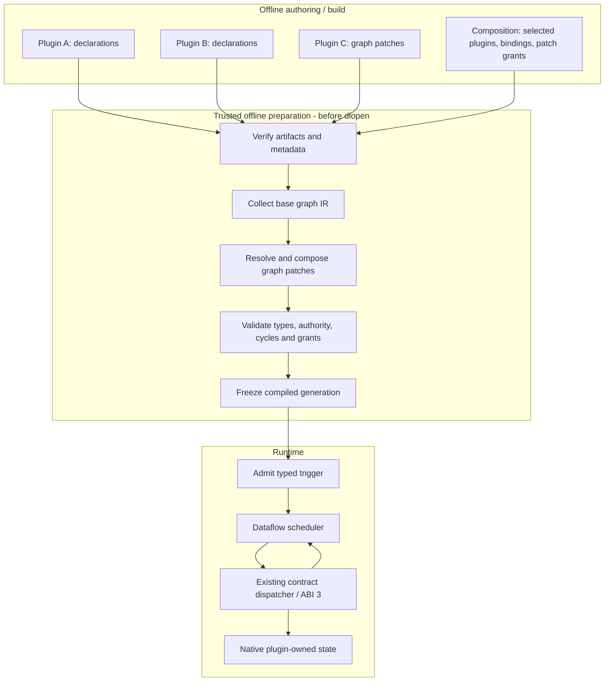

**Core/kernel responsibilities:** verification, graph composition/patch validation, trigger admission, typed value delivery, readiness, selected operation dispatch, root/activation identity, authorization, pending/cancel/drain, generation identity. **Outside kernel:** provider/account/auth logic, model transport and stream interpretation, agent policy, memory semantics, logging algorithms, plugin-private state, SQL persistence. Patches are pure metadata, not runnable plugin code.

### 1.1 Ownership boundaries

| Layer / module | Owns | Does not own |
|---|---|---|
| `phenix-contract::graph` | Portable typed graph/patch schema, IDs, canonical representation | Runtime scheduling or native handles |
| `phenix-macros`, `phenix-sdk::graph` | Developer ergonomics, static descriptors, typed node/edge/patch builders | Selection authority or alternative ABI |
| `phenix-artifact` | Signed/hashed artifact/metadata verification | Graph modification policy |
| `phenix-kernel::resolve` | Selected operation bindings and resource/grant policy | Domain registries |
| `phenix-kernel::graph::patch` | Pure patch conflict analysis, dependencies, projection | Executing handlers |
| `phenix-kernel::graph::compile` | Final graph topology, type checking, reachability, cycle/ownership checks | Live in-flight values |
| `phenix-kernel::graph::execute` | Root/activation-local values, readiness, switch/join/merge, pending lifecycle | Plugin business state |
| `phenix-kernel::runtime` | ABI 3 selected invocation, root authority, cancellation, physical lease safety | Interpreting agent/model provider responses |
| Native plugins | Contract handlers and private Rust state | Other plugins' state or kernel scheduling |

## 2. Data model — authored graph and compiled plan

### 2.1 Static definition (conceptual Rust; target types, not currently compiling)

The IR is **one canonical, offline description**. `SourceDecl` is the declarative identity of an admission source; `NodeKind::Source` is its non-executable output vertex. Neither creates a permanent root. `Order` has node endpoints, not meaningless typed data ports.

```rust
pub struct GraphContributionV2 {
    pub contributor: PluginId,
    pub sources: Vec<SourceDecl>,
    pub nodes: Vec<NodeDecl>,
    pub edges: Vec<EdgeDecl>,
    pub patches: Vec<GraphPatch>,
}

pub struct SourceDecl {
    pub id: SourceId,
    pub kind: SourceKind,
    pub payload: ValueSchema,
    pub security: PortSecurity,          // Bounded by verified source-owner ceiling
    pub owner: PluginId,                 // Verified against artifact identity
}
pub enum SourceKind {
    ExternalAction { action: ActionId },
    CustomEvent { event: EventId },     // Emitted from an active authorized root
    KernelEvent { event: KernelEventId },
    CommittedWatch { property: PropertyId },
    DeferredEntry,                      // Compiler-generated next-wave admission
}

pub struct NodeDecl {
    pub id: NodeId,
    pub kind: NodeKind,
    pub inputs: Vec<InputPort>,
    pub outputs: Vec<OutputPort>,
    pub execution: ExecutionPolicy,
}
pub enum NodeKind {
    Invoke { selector: ImportSelector, operation: OperationKey },
    Source { source: SourceId },
    Switch { tagged_schema: SchemaId },
    Merge { policy: MergePolicy },
    Join { policy: JoinPolicy },
    Constant { value: Value },        // Exactly one start: Flow<()> input; out: T
    // Struct assembly is optional post-V1; no implicit partial-request calls.
}

pub struct InputPort {
    pub name: PortName,
    pub schema: ValueSchema,
    pub readiness: InputReadiness,
    pub security: PortSecurity,
}
pub struct OutputPort {
    pub name: PortName,
    pub schema: ValueSchema,
    pub security: PortSecurity,
}

pub struct EdgeDecl {
    pub id: EdgeId,                      // Stable logical anchor
    pub kind: EdgeKind,
}
pub enum EdgeKind {
    Flow { from: OutPortRef, to: InPortRef },
    Order { before: NodeId, after: NodeId },  // Never activates or carries data
    Deferred { from: OutPortRef, to: InPortRef, next: DeferredWave },
}
pub enum DeferredWave { Next }

pub enum InputReadiness {
    One,                                 // Exactly one value in this wave
    Optional,                            // Zero/one; closed maps to Option::None
    StaticMany { min: u32, max: u32 },  // Finite statically enumerated incoming edges
}
pub enum MergePolicy { ExactlyOne }
pub enum JoinPolicy { All }

pub enum DomainErrorPolicy {
    RouteErr,                            // Deliver typed Error through err port
    SkipDependents,                      // Mark failed/closed according to policy
    FailRoot,                            // Stop graph admission on domain failure
}
pub struct ExecutionPolicy {
    pub on_domain_error: DomainErrorPolicy,
    // Kernel failure always aborts root; not a pluggable recovery policy.
}

pub enum Classification { Public, Internal, Confidential, Secret }
pub enum IntegrityClass { Untrusted, Validated, Trusted }
pub struct PortSecurity {
    pub confidentiality: Classification,
    pub integrity: IntegrityClass,
}
```

**Port projection:** At V1, a native `Invoke` has one complete typed `in: Request`, one `ok: Response` and one `err: Error` output, using the existing `Operation` contract. This avoids unspecified struct-field assembly. Later, a typed struct-assembly intrinsic may combine explicit field inputs only after all mandatory inputs resolve; its `ValueSchema::Struct` representation is unchanged. Defaults are permitted only on public fields and must be canonical portable literals. Nothing implicitly fills a missing required field.

**Optional delivery is not ambiguity:** A raw incoming `T` value mapped to an `Optional<T>` input is wrapped as `Some(T)` by the scheduler. A closed input becomes `None` (`Value::Null`), as already defined in `Portable for Option<T>`. An unreceived input is *not* `None` until all potential producers have resolved. A `StaticMany<T>` port collects a finite, statically known set of edge candidates in stable `EdgeId` order with declared `0 <= min <= max`. Closed candidates are skipped; successful values are ordered by `EdgeId`. Once every candidate is terminal, produce `Vec<T>` if `min <= delivered_values <= max` (including an empty list when `min=0`); otherwise resolve `Closed(CardinalityUnsatisfied)`. An unhandled `Failed` candidate fails the collection, overriding normal closure. No timer, partial snapshot, or external source occurrence closes a collection. Dynamically open-ended streams and their close protocol are **out of scope** until explicitly specified; they may not use timeouts to synthesize successful closure.

#### Readiness implementation clarification

**Status:** Partially implemented V2 continuation. Compiler and runtime Optional /
StaticMany readiness and native fixtures pass locally; exact-head single-store CI
and full V2 acceptance remain required and are not claimed here. **Date:**
27 October 2026. **Inspected commit:** `52b1c3261db182b9f595aac85d48fc238bddb83c`.
**Scope:** complete input schemas, causal absence, and authority preservation.
**Supersession:** none; makes the existing readiness/control-security rules
explicit. **Owner:** M1 roadmap V2, following Join #1175. **Acceptance:** canonical
schema/wire negatives, native Some/None/vector consumption, pending/failure
terminality, stable EdgeId ordering, dormancy, and narrowed-resource/control
classification tests before claiming compliance.

`InputPort.schema` describes the complete consumed value, including any outer
Option or List. One consumes that schema unchanged. Optional requires
`Option(T)` and accepts candidate payloads of exactly `T`; StaticMany requires
`List(T)` and accepts candidate payloads of exactly `T`. Only one outer layer is
removed to check an edge. Invoke still receives exactly one complete request
matching its selected OperationSchema; readiness never fills struct fields.
Switch, Merge and Constant retain their specified One-only intrinsic shapes.

Readiness does not create a source. Flow-only relevance to the admitted source
is checked before absence can activate a node. Disconnected or Order-only
Optional/min-zero nodes remain dormant. A relevant Join can use another causal
input as the activation bound for a missing Optional/min-zero field. Required
satisfiability obligations exclude Optional and min-zero collection inputs.

Closure that can become observable None or an empty collection retains
kernel-owned causal/control evidence and its attenuated resource bound. Closure
from an inactive source supplies terminality, not authority from that source.
Synthesis intersects the actual causal bounds and applicable prepared flow
policy; it never falls back to the full root scope when evidence is absent or
an intersection is empty. Observable absence outside the effective resource
grant fails closed. Non-runnable consumers still discard late successes without
performing a nonexistent destination delivery. None/collection presence, size
and omissions retain conservative candidate/control security labels.

**Zero-data control:** `Struct{}` is the existing portable `()` value carried on a `Flow`. `Order` carries no value and never activates. `Closed` and `Failed` are kernel scheduler states, not fabricated plugin `Value`s. A `Constant<T>` has one required `start: In<()>` and one `out: Out<T>`. On one successful `Flow<()>` arrival per wave it emits its verified Public literal once. If `start` closes or fails, output respectively closes or fails. An `Order` edge cannot activate it; source-triggered constants must be explicitly connected with a unit-valued Flow. Untriggered constants remain dormant. The compiler validates this shape and activation reachability.

### 2.2 Entity/data relationship

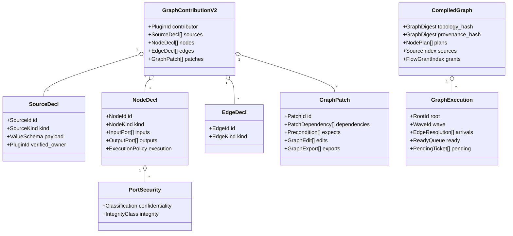

### 2.3 Identities and lifetime

| Identity | Scope and stability |
|---|---|
| `NodeId` | Authored `plugin/node`; stable unless explicitly removed/replaced |
| `PortRef` | `(node_id, port_name)`; canonical schema and port-security checked |
| `EdgeId` | Stable original logical anchor independent of compiler-generated physical segments |
| `PatchId` | `plugin/patch`; unique provenance identity, not a global scheduling key |
| `ExportRef` | `(logical_anchor, export_name)`; resolves to a unique effective winning export |
| `GraphDigest` | Canonical effective topology, schemas, source semantics, and selected route declarations |
| `ProvenanceDigest` | Canonical enabled patches, winner/loser decisions, exports, grants and base identities |
| `GenerationId` | Selected artifacts, graph digest, bindings and grants; old roots stay pinned on reload |
| `RootId` | One externally admitted execution/security/cancellation context |
| `WaveId` | One same-root source occurrence, including same-root emitted/deferred events |
| `(RootId, WaveId)` | Initial correlation key for independent fan-out/fan-in; no implicit cross-wave accumulation |

A graph may have arbitrarily many disconnected components or dormant nodes. A persistent source declaration does not retain a root. Roots are instantiated per admitted external event, while plugin-emitted and deferred events initiate additional waves *within* their already admitted root. Existing M1 admits serial roots; this proposal does not claim concurrent root support.

No root/wave IDs or live `Value`s appear in inspectable graph descriptors. `Order` edges do not connect flow reachability sets or imply cross-root synchronization.

## 3. Finite-wave execution algebra and built-in operators

### 3.1 Independent triggers, disconnected components and roots

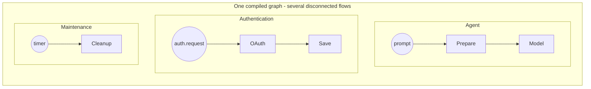

One **external trigger occurrence** creates one admitted `RootId` and one starting `WaveId`. A persistent external source that fires again creates a new root, not another wave in its old root. A committed-state watch triggered by a mutation inside a live root creates a new wave in that root; an independently admitted external change is a separate authorized root. A plugin-owned event emitted inside an existing root and `Deferred::Next` each enqueue a **new wave under that same root**. An external event source waiting to fire is not outstanding root work. The current M1 kernel admits serial roots; concurrent roots require separate lifecycle/ABI work.

A wave is the **finite causal projection of one admitted source occurrence**. Fan-out duplicates deliveries but preserves `(RootId, WaveId)`. Different triggers never satisfy one another's joins by accident. Nodes reachable from several sources are valid and execute separately per source wave. A node may be invoked at most once per wave in the initial profile; re-entry requires another wave.

### 3.2 Cross-source convergence and compile-time satisfiability

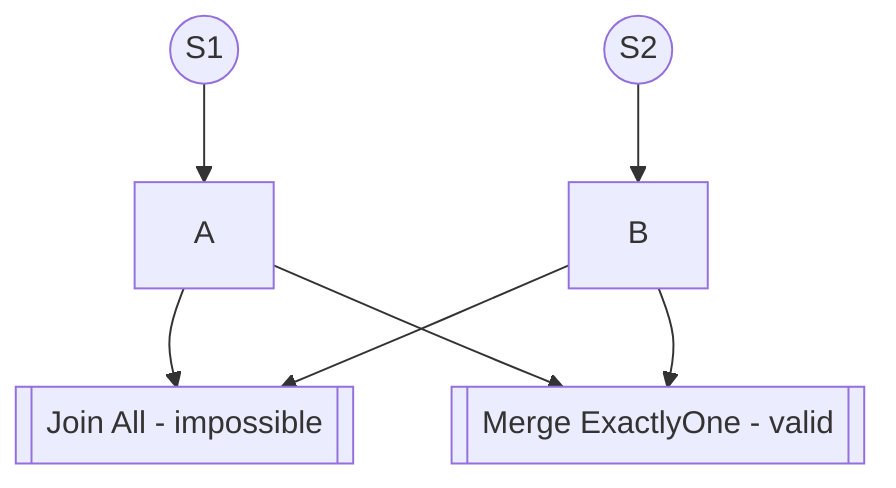

The two sources never deliver into the same wave. **`Join::All` in this example is statically unsatisfiable and must be rejected**; **`Merge::ExactlyOne` is valid**, receiving exactly one input per source-specific wave. Do **not** require every input/node to be reachable from exactly one source: alternative sources are legitimate.

For an input `p`, let `R(p)` be its set of potential same-wave trigger sources, computed over `Flow` paths only (ignoring `Order` and crossing `Deferred` only as a new-wave source). For `Join::All` inputs `p1..pn`, a necessary condition is:

$$
\bigcap_{i=1}^{n} R(p_i) \neq \varnothing
$$

If empty, reject as `UnsatisfiableJoin`. A nonempty intersection is not sufficient: two mutually exclusive outputs of one `Switch` cannot satisfy a required join in one wave. The compiler also uses recognized intrinsic switch exclusivity to reject *provably* impossible joins. For arbitrary plugin-side predicates, it does not solve general satisfiability; conditionally satisfiable joins may close normally at runtime. **v2.4 static scope:** compute source reachability and direct intrinsic-switch case exclusion. Bounded local intrinsic checks can prove additional obvious impossibilities, but **composed path reasoning through nested `Switch → Merge → Join` is not required for V1/V2**. Such cases receive an explicit `Satisfiability::Unknown` diagnostic when not proven. Runtime closure and failure-resolution rules always guarantee termination of a finite wave; acceptance of `Unknown` is not a claim that the join is satisfiable. The compiler rejects only `ProvenImpossible`, not `Unknown`. Unreachable required nodes that can never activate should be diagnosable as dormant, not treated as a global graph-entry violation.

For each wave, **every candidate edge to a relevant input must eventually become terminal**: `Value`, `Closed` or `Failed`. Inactive source paths resolve `Closed(InactiveSource)` as soon as the wave's reachable closure is established. They do not remain `Unresolved` waiting for a future external source occurrence.

### 3.3 Formal delivery states and deterministic terminal reduction

```rust
pub struct ActivationKey { pub root: RootId, pub wave: WaveId }

// Scheduler-local only; not ABI 3 values or plugin-owned state.
pub enum EdgeResolution {
    Unresolved,
    Value(Envelope),
    Closed(CloseReason),
    Failed(ExecutionFailure),
}
pub enum ExecutionFailure {
    Domain(DomainFailure),
    Kernel(Failure),
}
pub struct Envelope {
    pub activation: ActivationKey,
    pub payload: Value,                  // Portable immutable value
    pub provenance: Provenance,          // Kernel-owned, not payload-controlled
    pub security: PortSecurity,          // Effective classification/provenance
}
```

Resolution is tracked **per incoming edge**, not only per input port. An input with multiple candidate producers derives one deterministic result after accounting for all *potentially active* candidates. `Unresolved` means a producer may still deliver in this wave; it is never a successful absence. When all eligible sources are terminal, reduce their outcomes according to the input/operator policy.

**Failure precedence:** unhandled `Failed` dominates normal `Closed`, regardless of completion order. When more than one failure applies, choose a deterministic canonical error (e.g. by stable incoming `EdgeId`) for reporting while preserving all failures in diagnostics. Kernel failure immediately stops the root and cancels/drains as required; it is never a value routed through `err`.

**Two-stage join closure (avoids timing dependence):** A required `Closed` marks `Join::All` **NonRunnable** immediately; it will never invoke its handler and may stop retaining payloads from remaining predecessors. However, the join **does not publish its final `Closed` output** until other relevant incoming branches become terminal (or the root aborts), because a later active failure must dominate closure. Late successful deliveries to this non-runnable consumer are dropped, not buffered or treated as errors; active failures are still recorded. This prevents arrival-order-dependent downstream effects. A producer is not automatically cancelled because its consumer is non-runnable.

### 3.4 Intrinsic operator rules

| Intrinsic | Ready/success behavior | Closed behavior | Failed behavior |
|---|---|---|---|
| `Switch<Tagged>` | Emits exactly one matching typed case | All unselected outputs close | Active failure propagates |
| `Merge::ExactlyOne` | After candidates terminal: one value forwards | Zero values closes; more than one value fails | Any active unhandled failure fails; never silently ignored |
| `Join::All` | After all required values present, emits a typed assembled value | A closed required input makes node non-runnable; terminal publication follows §3.3 | An active failure takes precedence over closure |
| `Invoke` | Valid full `Request` admitted to existing dispatcher; `ok` gets `Response` | Closed required input closes invocation outputs | Domain failure routes per policy; kernel failure aborts root |
| `Source` | Source occurrence emits typed payload once per wave | An inactive source closes its outgoing candidates | Invalid/unauthorized source admission fails |
| `Constant<T>` | Requires one `start: In<()>` Flow value; emits Public literal once per wave | Inactive/closed `start` closes output | Failed `start` fails output |
| `StaticMany<T>` (input readiness) | At terminality, collect `Value(T)` candidates in canonical `EdgeId` order if `min <= count <= max` | Skip closed candidates; close if cardinality below `min` | Any active unhandled failure fails the collection |
| `Order` (edge) | A wait condition only when both endpoints are potentially active in same wave | Inactive/closed predecessor satisfies order without activating successor | Domain failure is terminal for ordering; kernel failure aborts root |
| `Deferred::Next` (edge) | Valid typed value queues a new wave under same root | Closed produces no new wave | Failure follows the error policy; no implicit background job |

`Switch` exhaustively matches the already supported `ValueSchema::Tagged`. A `Merge` of alternative sources does not blend roots. Normal successful domain-error routing is **not** an `EdgeResolution::Failed`: when `DomainErrorPolicy::RouteErr` applies, the typed error value is delivered on the `err` port, and `ok` closes. Otherwise the declared domain error is recorded as `Failed(Domain)` for propagation or root failure depending on policy. `SkipDependents` affects only reachable descendants; unrelated started work remains governed by its own policy. `FailRoot` terminates further admissions for that root.

An `Order` predecessor that fails with a *domain* outcome is terminal for ordering but does not synthesize the successor's required `Flow` value. Order never catches kernel failure or converts failure into success.

### 3.4.1 Normative intrinsic output-security rules

Security is a product lattice: confidentiality joins toward **Secret** (`Public < Internal < Confidential < Secret`), while integrity joins toward **less trusted** (`Trusted > Validated > Untrusted`). The compiler uses these declared upper/lower bounds conservatively; it cannot prove what arbitrary native code does with values. A closure, failure, selected-case identity and operator trace may reveal control-flow information and must be protected/redacted at the classification of the control input.

| Operator | Confidentiality of effective output | Integrity of effective output | Enforced restriction |
|---|---|---|---|
| `Source` | Exactly its verified source-port declaration, bounded by owner/composition ceiling | Declared and attested source integrity; never upgraded by trigger admission | A source cannot self-grant Secret provenance or downstream access |
| `Switch<Tagged>` | At least classification of the **whole input**, including tag/branch selection; no implicit Public downgrade for a Public discriminant attached to a Confidential value | No stronger than input | Each emitted case and observable branch outcome inherits control-input bounds; finer tag/payload separation requires a separately verified splitting operation |
| `Merge::ExactlyOne` | Join of **all possible** incoming port classifications, even when only one case is selected at runtime | Least trusted of possible inputs | Branch identity can itself reveal information; static bounds do not depend on arrival timing |
| `Join::All` / `StaticMany` | Join of all connected candidate port classifications | Least trusted among candidates | Aggregate label covers structural/collection metadata as well as values |
| `Constant<T>` | `Public` only | `Untrusted` unless a separately attested trusted static source is specified in a later revision | Literal and schema are inspectable; no references/capabilities |
| `Invoke` | Verified output-port declaration; if it is lower than the joined input confidentiality, an exact declassification declaration **and** matching composition grant are required | Any upgrade over input requires independently authorized endorsement | Mere output-schema assertion is not proof of sanitizer correctness; native implementation remains trusted for the declared transformation |

No graph patch may lower effective confidentiality or raise effective integrity by editing port metadata. A selected handler's verified declassification or endorsement, bound by composition and root scope, is the sole exception. The static join is conservative by design; if users want case-specific downgrades they must call an explicitly verified operation.

### 3.5 Pending consumers, terminality, and root lifecycle

```mermaid
sequenceDiagram
    participant Ext as External source
    participant Root as Root R1
    participant A as Producer A
    participant B as Pending producer B
    participant J as Join J
    Ext->>Root: Admit event S1; create Wave W1
    Root->>A: Invoke
    Root->>B: Invoke pending
    A-->>J: Closed(required input)
    Note over J: NonRunnable; no successful join possible
    B-->>Root: Pending until ready or cancellation
    B-->>J: Value or Failed
    Note over J: Value discarded; failure recorded
    J-->>Root: Publish Closed or Failed after terminal reduction
    Root-->>Ext: Complete only after queues and worker drain
```

A downstream closure **does not by itself cancel** upstream pending operations. When a consumer is non-runnable, subsequent success deliveries are discarded; the pending producer retains its existing M1 root, selected binding, resource scope and physical lease. Explicit root cancellation or a separately authorized safe-to-cancel policy may cancel it. A root must not report final quiescence until its pending workers are completed or physically drained.

A root completes only when all its admitted waves have no runnable/unresolved work, pending effects have completed or drained, and same-root event/deferred queues are empty. A persistent *source declaration* is not waiting work. A source that fires twice creates **two** roots (subject to current serial admission), not two waves in one root.

### 3.6 Deferred admission and bounded termination

Same-wave `Flow` and `Order` dependencies must be acyclic. Only `Deferred::Next` crosses wave boundaries. Deferred carries typed values through the existing root's authority and generation, never creating a new root or durable job. Waves are admitted in deterministic FIFO sequence; fan-out ready-order is canonicalized by stable node/edge ID when logically concurrent, so race timing does not choose branch order.

Enforce explicit nonzero bounded limits for waves/root, values and bytes/root, queue depth, pending tickets/root, node executions/root and graph fan-out/depth. Resource exhaustion produces a kernel failure; cancellation prevents new deliveries and drains physical leases. Numerical defaults are deliberately left to native product measurement; they must be frozen and tested before release. A root may not complete with a deferred wave queued.

### 3.7 Runtime invocation sequence

#### Deferred base-profile addendum (29 October 2026)

The base declaration encoding for `DeferredWave::Next` is an edge kind object
with exactly `kind: "deferred"`, `from`, `to`, and `next: "next"`. Port references
use the same node/port objects as Flow. Authored DeferredEntry sources remain
unsupported; a deferred edge itself identifies its compiler-owned admission.
Each selected successful delivery queues one separate wave. Closed and failed
outputs do not enqueue values. At wave settlement, emitted activations are
appended in canonical EdgeId order to the root FIFO, after existing queued work.
Admission waits for physical ticket drain and allocates successive root-local
activation IDs starting with zero for the external wave. No candidate or join
state is shared between waves. Existing dispatcher, cancellation, generation,
and attenuated delivery authority remain authoritative.

The implementation bounds each root to 256 waves (including the initial wave),
1,024 queued deferred activations, 4,096 node resolutions, 16,384 values and
16 MiB of encoded values. Values and bytes include successful outputs and edge
deliveries; these counters are cumulative, not reset at deferred admission.
Exhaustion is InfrastructureFailure and stops root admission. These are current
implementation defaults, not a claim of completed native release acceptance.

```mermaid
sequenceDiagram
    participant External as External trigger
    participant Graph as M1 GraphExecution
    participant Flow as Typed scheduler
    participant Dispatcher as Existing M1 dispatcher
    participant Plugin as Native plugin ABI 3
    External->>Graph: Admit event with effective root authority
    Graph->>Flow: Create (RootId, WaveId); source emits typed payload
    Flow->>Flow: Resolve matching typed input and readiness
    Flow->>Dispatcher: Invoke selected operation(request)
    Dispatcher->>Plugin: ABI-3 invoke / pending poll
    Plugin-->>Dispatcher: Success(Response) or Domain(Error)
    Dispatcher-->>Flow: Validated typed completion
    Flow->>Flow: Terminal edge resolution and security check
    Flow->>Graph: Enqueue downstream; close inactive branches
    Graph->>Graph: Drain same-root event/deferred waves and tickets
    Graph-->>External: Terminal completion
```

The ABI-visible request/response remains portable `Value`, not an `Envelope`. Source provenance, classification, root/wave IDs and closure stay under kernel control. Read-only references must still be independently authorized when dereferenced; a `Value::Ref` never conveys authority by itself.

## 4. Arbitrary graph transformation — declarative patches

A plugin may express any **finite, statically describable** edit to the graph IR: adding/removing nodes or edges, replacing an operation, changing ports/policies, rerouting triggers, replacing an edge with a fragment, or inserting middleware. General `Edit` primitives and atomic graph fragments provide expressiveness; specialized ergonomic helpers lower to them. This is not an arbitrary Rust callback executed during preparation.

### 4.1 Patch representation and stable anchors

```rust
pub struct GraphPatch {
    pub id: PatchId,                      // Verified plugin-qualified ID
    pub dependencies: Vec<PatchDependency>,
    pub expects: Vec<Precondition>,      // Checked against effective graph
    pub edits: Vec<GraphEdit>,           // Atomic: all or nothing
    pub exports: Vec<GraphExport>,       // Named interfaces for dependent edits
}
pub enum PatchDependency {
    ExactPatch(PatchId),                 // Fails if producer is superseded
    EffectiveExport(ExportRef),         // Binds to effective winning export
}
pub struct ExportRef {
    pub anchor: LogicalElementId,
    pub name: ExportName,                // Scoped by logical anchor
    pub expected_kind: ElementKind,
    pub expected_schema: Option<SchemaId>,
    pub expected_security: Option<PortSecurity>,
}
pub struct GraphExport {
    pub anchor: LogicalElementId,
    pub name: ExportName,
    pub target: AuthoredElementRef,      // Explicit stable exported node/port/edge
}

pub enum GraphEdit {
    AddNode(NodeDecl),
    RemoveNode { node: NodeId },
    ReplaceNode {
        node: NodeId, fragment: GraphFragment,
        ports: PortMapping, override_priority: Option<i32>,
    },
    ConfigureNode {
        node: NodeId, change: NodeDelta,
        override_priority: Option<i32>,
    },
    AddEdge(EdgeDecl),
    RemoveEdge { edge: EdgeId },
    ReplaceEdge {
        edge: EdgeId, route: RouteFragment,
        override_priority: Option<i32>,
    },
    ConfigureEdge {
        edge: EdgeId, change: EdgeDelta,
        override_priority: Option<i32>,
    },
    Splice {
        edge: EdgeId, at: Position, via: NodeId,
        splice_order: Option<u32>,       // Non-negative; lower is closer to source
    },
    AddSource(SourceDecl),
    RemoveSource { source: SourceId },
    RerouteSource { source: SourceId, to: InPortRef },
}

// Canonical exact rational in lowest terms, strictly 0 < n/d < 1.
pub struct Position { pub numerator: u32, pub denominator: u32 }
pub struct GraphFragment { pub nodes: Vec<NodeDecl>, pub edges: Vec<EdgeDecl> }
pub struct RouteFragment {
    pub graph: GraphFragment,
    pub input: InPortRef,
    pub output: OutPortRef,
}
```

`Position` is canonicalized to a reduced exact rational, strictly between zero and one with bounded numerator/denominator. `splice_order` is an optional non-negative `u32`; negative values are invalid even in non-Rust declaration encodings. The SDK accepts `pos!(1/5)` and `position_decimal("0.2")`; **no floating-point authoring API**. All inserted nodes, connections and operations are verified against selected bindings and grants. `Splice` requires an input/output-compatible node. An interceptor receives protected data only with an independent flow grant.

`ReplaceNode` reconnects incident ports by explicit `PortMapping`; unmatched incident edges must be removed explicitly in the same atomic patch or by a declared dependency. `RemoveNode` never silently cascades over unknown edges.

**Named exports:** Dependent patches refer to `(logical_anchor, export_name)` and declare expected kind/schema/security. For data-bearing ports/edges, `expected_security` is mandatory and defaults to **exact confidentiality and integrity equality** at effective-export rebinding; an explicitly declared bounded compatible range may opt into variation, but it never overrides declassification, flow grants or the dependent's maximum access. A lower classification may invalidate trust assumptions; a higher classification may exceed the dependent's authority. Structural no-data exports may omit the security expectation. The effective winning replacement supplies the export. An explicit `ExactPatch(P)` dependency fails if P is superseded; an `EffectiveExport` dependency may bind to a different winning provider *only after compatibility and authority checks*. Competing applied patches exporting the same qualified name without a supersession relation conflict. Export identities derive from `(contributor_id, patch_id, exported_local_id)`; physical splice segments that are not explicitly exported are compiler-internal and cannot be targeted. This avoids unstable generated-edge references.

### 4.2 The requested insertion example

```rust
// Convenience API, lowered into GraphPatch.edits:
patch("observability").splice(edge!(a.out => b.in), d, pos!(1/5));
patch("metrics").splice(edge!(a.out => b.in), c, pos!(1/2));
```

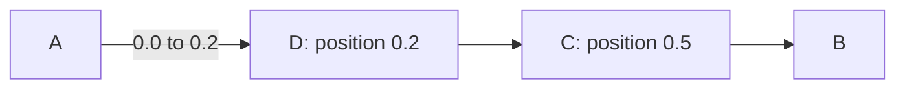

The compiler identifies both insertions against the **same original logical** edge ID, sorts by exact position, validates every derived adjacent type boundary, and materializes stable generated edges. The author's declaration order and package load order have no influence. Materialized segments have compiler-internal deterministic identities derived from the anchor and contributing splice IDs; dependent patches must target explicitly exported logical interfaces, never incidental physical segments.

### 4.3 Replacement versus insertion

```rust
patch("audit").replace_edge(edge!(a.out => b.in), via!(logger));
patch("trace").replace_edge(edge!(a.out => b.in), via!(tracer));
```

These are *exclusive* `ReplaceEdge` edits on the same logical anchor. With no specified `override_priority` on every contender, reject the graph with both patch IDs and their target edge. With distinct explicit priorities, the greatest wins and losers are recorded as superseded. Equal priorities fail.

**Important distinction:** a `Splice` is an additive, composable middleware insertion; a `ReplaceEdge` is an exclusive rewrite. A replacement of an edge that is also independently spliced is conservatively an error, because there is no meaningful default for where those splices fit inside the replacement fragment. Authors can explicitly depend on the winning replacement's **exported** logical edge or port, and target that export with a separate graph patch. This preserves arbitrary composability without inventing implicit behavior.

### 4.4 Conflict algebra (not global plugin ordering)

| Pair of changes | Compatibility | Resolution |
|---|---|---|
| Add different node/edge IDs | Commutes | Both, independent |
| Insert on same edge at **different** positions | Commutes | Sort exact positions ascending |
| Insert on same edge at **identical** position | Conflict/order-sensitive | Distinct explicit `splice_order`; lower nearer source; equal/unspecified fails |
| Replace same edge twice | Exclusive conflict | Each contender specifies `override_priority`; highest wins; tie fails |
| Set same node field to different values | Exclusive conflict | If field supports override, explicit `override_priority`; otherwise reject |
| Modify disjoint fields on same node | Commutes | Both |
| Remove node versus modify node | Conflict | Reject unless dependent, and latter retargets replacement identity |
| Replace edge versus splice original edge | Conflict | Reject; dependent patch must target replacement export |
| `ReplaceNode` versus independent `AddEdge` to a replaced node's incident port | Conflict | Reject, even when named ports appear compatible; require an explicit dependency and checked `PortMapping` |
| Change input type versus existing incompatible edges | Final schema invalid | Reject regardless of priority |
| Two unrelated patches with declared local conflict priorities | Independent | Ignore priorities; no global sequencing |
| Patch refers to node created by another | Dependency | Require `ExactPatch` or `EffectiveExport` dependency as appropriate |

`splice_order` and `override_priority` are **not** substitutes for arbitrary execution order. Each applies only to the conflict class that explicitly defines it. Where two patches are irreconcilable, the compiler reports the conflict even if one has a greater numeric priority. Priority cannot override type safety or mutation authority.

### 4.5 Patch ordering, effective exports and commutativity

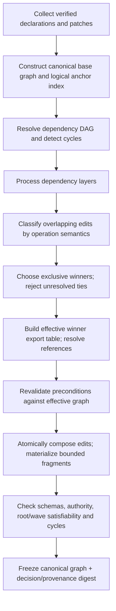

**Algorithm:** (1) Build stable base declarations and logical anchors; (2) resolve a directed acyclic patch dependency graph; (3) partition into dependency layers; (4) compute operation-aware read/write/target sets; (5) compose independent operations and select exclusive winners; (6) publish the *effective* export table only for selected applied patches; (7) resolve export dependencies and recheck preconditions against that effective graph; (8) apply each patch atomically; (9) type-check and authorize the resulting graph and compute canonical hashes. Missing exports, collisions, ambiguous winners, cycles, invalid preconditions and unauthorized rewrites reject the generation.

**Commutativity:** For semantically independent patches `P,Q`, canonical `apply(P,apply(Q,G)) == apply(Q,apply(P,G))`. The same graph, decision report and hashes arise under any plugin/package/declaration permutation. Canonical IDs are used for sorting and diagnostic reproducibility, never as a hidden conflict winner. Superseded patches are recorded but do not contribute applied edits or exports. Their explicit dependents fail; effective-export dependents rebind only when the winning export meets required kind/schema/security/grant constraints.

**Atomicity:** A patch is all-or-nothing, and no partial intermediate graph is visible at runtime. A patch that references a superseded patch by exact ID fails its precondition; no implicit string-based retargeting occurs.

### 4.6 Preconditions and diagnostics

Supported preconditions: `edge_exists`, `node_exists`, `port_schema_is`, `operation_key_is`, `export_is(ExportRef)`, `descriptor_is`, and `match_count_exactly(1)`. They refer to the **effective** graph following supersession decisions and previously completed dependency layers. Pattern matching is bounded and requires deterministic cardinality. Unstable generated physical segments are not public targets.

The compiler emits a canonical **patch decision report** with per-patch application, supersession, dependencies, effective export owners, conflict classification, invalidated preconditions, approved/denied grants and provenance of each materialized element. Inspection cannot reveal secret values or protected reference contents.

## 5. Security / ABI boundary

### 5.1 ABI and descriptor flow

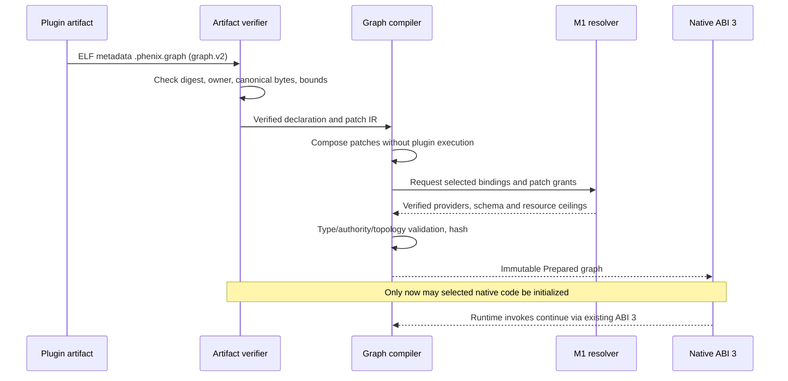

**Wire versioning:** Introduce canonical `phenix.graph.v2` metadata inside the existing verified graph section, with explicit fixed field names, enum discriminants, normalization, size/depth bounds, and a domain-separated hash. This is a **graph declaration format revision**, not an ABI-3 table revision. ABI-3 `StateHostApi`, `StatePluginTable`, `Bytes`, `Reply`, and `invoke/poll/cancel` remain unchanged. No Rust trait objects, closures or function pointers cross the ABI. `NodeKind::Switch` and `NodeKind::Merge` are executed in the kernel over canonical `Value`, with no selected plugin call. The native provider invocation path is still resolved by the existing import table and operation grant checks.

**Temporary migration adapter:** During conversion, verified graph.v1 descriptors can be lowered offline to a graph.v2 intermediate form: `triggers` become explicit Source-to-node `Flow` edges and `after` becomes `Order` edges, preserving current **non-activating** behavior for `after`. Existing event wave and state-watch semantics must be regression-tested. This is an internal bridge that should be removed after canonical migration, rather than carrying permanent M0/M1-style compatibility code.

### 5.2 Explicit graph mutation authorization

#### Base-profile implementation boundary (27 October 2026)

**Status:** Partially implemented, not V0 acceptance. **Inspected base:**
`167b60eab86e1b6b140c6a5f17de5285bba3280f`. **Scope:** canonical offline
base declarations and trusted preparation, owned by the M1 roadmap and
[PR #1172](https://github.com/matthis-k/phenix-ai/pull/1172).
**Supersession:** no target decisions or graph-v1 runtime behavior superseded.
**Acceptance:** canonical/negative tests plus exact-head native V1 and existing
P1 gates; unit tests alone do not close this boundary.

The initial implementation accepts Source, Invoke, Constant, Flow and Order
with One inputs. Other intrinsics/readiness, deferred admissions and nonempty
patch lists reject explicitly, rather than acquiring substitute semantics.
Declarations use the existing canonical `Value` wire format with fixed root
fields `format`, `contributor`, `sources`, `nodes`, `edges`, `patches` and format
`phenix.graph.v2`. Declaration and port order normalize before encoding;
decoding rejects noncanonical order, unknown fields and discriminants.

Verified native graph bytes must match their artifact owner. Trusted v2
preparation uses the existing M1 resolver and stores the compiled plan in the
prepared generation; the legacy preparation profile rejects v2 metadata and
the v2 profile rejects mixed v1/v2 graph contributions until lowering is tested.
Existing package metadata does not attest native security labels. Therefore
the trusted host must supply exact operation/source label attestations and both
source-owner and composition ceilings independently of authored declarations.
Missing attestations fail closed; they are not inferred from plugin metadata.
Declassification and endorsement are unsupported and reject in this profile.

Base-edge authoring is also topology mutation: an edge contributor touching a
foreign node needs an explicit topology authorization for that target, including
Order edges. This is independent of selected-operation grants and exact
endpoint-pair delivery grants. Offline authorization is only a potential-route
check; it does not replace effective-root/resource enforcement at delivery.
Reference delivery still cannot grant reference access.

An initial graph dependency-depth cap of 256 bounds traversal of the shared DAG
algorithm. Aggregate declaration bytes and contribution/source/node/edge counts
are checked before resolution/traversal using existing canonical wire limits.
These are conservative initial-profile limits, not measured P1 release defaults.

The initial runtime uses the existing `GraphExecution`, admitted `Root`, selected
dispatcher and pending tickets, with private per-edge readiness for one initial
wave. It bounds admitted nodes at 4,096, produced/delivered values at 16,384 and
accounted value bytes at 16 MiB per root. These limits are explicit test-profile
backstops, not measured release defaults. Dormant inputs close; Order alone does
not activate a node, and active Source vertices honor their Order dependencies.
Delivery intersects trusted flow resources with inherited operation resources
and effective root scope. V2 completion waits for physical drain. Trusted host
`steps()` retains results; the existing payload-bearing `NodeFinished` observer
notification is suppressed for this profile. General classified observation and
wave inspection remain separate acceptance work.

**Basic single-model-stage freeze (29 October 2026):** The bounded Basic
graph turn consumes its exact prepared-request admission once, then starts
exactly one selected `Host::begin<Model::complete>` per non-cached model stage.
Its pending handler retains the existing imported-child ticket; polls only
that child and stores the successful reply for the downstream graph stage.
The cached final-reply shortcut starts no import. Immediate and polled failures
use the same domain/session or kernel-failure reconciliation. No model-stage
callback runs the Basic advance loop, executes tools or prepares another turn.
Cancellation clears active graph state without journal/session writes under
revoked authority; the kernel owns child cancellation and physical drain.
This increment does not change graph-v1 execution or claim full P1 parity.

**Operator continuation (27 October 2026):** Partially implemented, inspected
base `12e6f7becd0d3cd0ee1a63aec8b7b4ff4acb3c64`, owned by the M1 roadmap's V2
slice following #1172. This extends, rather than supersedes, the initial profile;
it does not change the target decisions or claim full V2/P1 acceptance.
Switch has one `One in: Tagged` and exhaustive case-named outputs; payloadless
cases emit portable unit. Merge::ExactlyOne has one `One in: T` accepting a finite
set of candidate Flow edges and one `out: T`. Other One ports remain restricted
to at most one candidate in this implementation profile. Every candidate must
be terminal before Merge publishes: active failure dominates closure/values,
zero values close, and one forwards. Multiple values violate the intrinsic
graph constraint and cause a kernel infrastructure failure; no domain-error
value is fabricated. Switch preserves the whole control-input security bound;
Merge input/output bounds cover every candidate, not just the selected value.
Forwarding retains the selected value's attenuated resource scope.

Acceptance includes native text/unit routing, cross-source convergence,
pending-candidate waiting, late failure precedence, multiple-value rejection,
all-closed termination, and independent topology/delivery denial tests, plus
canonical wire negatives and resource/security propagation. Join and extended
readiness remain unsupported and full V2 acceptance remains open.

`GraphExecution`, its callback, completion and pump result are privileged Rust
control-plane APIs for the trusted root owner; they may expose classified
success/failure and timing information. They are not a selected plugin observer
contract. Suppressing `NodeFinished` payloads does not hide those control bits.
Any forwarding to an untrusted observer, stream or logging sink requires a
separately authorized classification-aware export. Native plugins receive no
graph callback handle through ABI 3. General classified observation remains an
explicit gap, not an implied right granted by observing root completion.

**Join continuation (27 October 2026):** Partially implemented, inspected base
`64f6274a3ad025d1440eedd354a52d99dd0df894`, owned by the M1 roadmap V2
continuation. This extends the supported intrinsic profile without superseding
the target semantics. Join::All has one or more named One inputs and one `out`
whose canonical struct fields exactly match those input names and schemas. It
is explicit assembly, not implicit partial-request invocation. Its output label
conservatively covers every input, and successful resource scopes intersect.

An unreachable required input is diagnosed as dormant. Otherwise disjoint
source sets and direct different-case outputs of the same Switch reject as
`UnsatisfiableJoin`. Direct same-source fanout can be proved satisfiable;
unproven composed paths report deterministic `Satisfiability::Unknown` and still
settle through runtime closure. No general predicate solver is implied.

Required closure makes the Join permanently non-runnable immediately. Existing
success payloads are released and late successes dropped, while terminal edge
bookkeeping remains until all candidates settle. A late active failure wins
over ordinary closure. Neither closure nor payload release cancels a pending
producer. Acceptance includes native pending fan-in, typed field assembly,
closed-plus-late-failure and closed-plus-late-success without consumer execution,
producer non-cancellation and physical draining, plus offline satisfiability,
security, resource-intersection and canonical-wire negatives. Optional and
StaticMany readiness remain unsupported; this is not full V2 or P1 acceptance.

Discarding a late success performs no destination delivery: destination-resource
denial must not turn that discard into an error. Potential-route authorization
at compilation, producer invocation authority and producer resource accounting
still apply; other runnable recipients independently retain their delivery
checks. Unselected outgoing closures are resolved before selected payloads so
same-producer closure cannot make this behavior depend on logical edge-ID order.

A graph patch is a *requested change*, never a capability. A composition grants authority to specific patch contributors and target scopes, for example:

```rust
// Composition / resolver policy, not user-supplied graph event data.
pub struct GraphPatchGrant {
    pub contributor: PluginId,
    pub targets: Vec<GraphSelector>,
    pub allowed_edits: Vec<GraphEditKind>,
}
```

For edits targeting another plugin's nodes/edges, require an explicit composition-approved mutation grant. For new flow routes crossing trust boundaries, also check that the target plugin/operation was selected, that the triggering root can authorize the destination invocation, and that input-flow/resource policies permit the recipient to receive the data. A patch may not forge an event owner, change the owner of a native operation, add a missing selected provider, bypass runtime grants or make a private secret-bearing port public. Logging interceptors are **not** automatically allowed to receive credentials. If the existing grant language cannot express a cross-plugin dataflow rule, introduce an explicit prepared **flow authorization policy**, not a runtime plug-in-controlled exemption.

Authorization is checked at both offline compilation (potential route) and runtime admission (effective root scope). Compilation never trusts plain provider names or executor indexes in patch payloads; it resolves typed selected identities through M1.

### 5.3 Flow authorization, port classification and declassification

Graph mutation grants and dataflow grants are **orthogonal**. Permission to add `A -> Logger` does not grant Logger access to A's output. At compilation, each cross-boundary `Flow` is checked against selected, artifact-attested port metadata, a composition-issued flow grant and the selected destination operation; no patch can mint such grants.

```rust
pub struct FlowGrant {
    pub source: OutPortRef,
    pub destination: InPortRef,
    pub resources: ResourceScope, // Resolved grant bound; not a live RootId
    pub maximum_classification: Classification,
}
pub struct VerifiedDeclassification {
    pub operation: OperationKey,
    pub input: InPortRef,
    pub output: OutPortRef,
    pub from: Classification,
    pub to: Classification,
    pub resources: ResourceScope,
}
```

**Source ceilings:** An authored `SourceDecl.security` is checked against the **verified declaring owner's classification ceiling** and the **composition-authorized ceiling**; the effective ceiling is their intersection. The artifact's self-description is not sufficient to grant Secret handling. A source above either ceiling rejects at preparation. Declaring a high-classification source never causes automatic flow grants or makes other plugins accept its values. `KernelEvent` and external admissions are subject to the same checks, using their trusted owning authority.

A lower-classified output from a higher-classified input requires **both** (a) that the selected operation's verified descriptor declares that declassification and (b) an explicit composition-issued declassification grant. No patch may relabel a native operation's ports. For integrity/trust elevation, use a separate authorized validation endorsement; confidentiality and integrity are not the same axis. A compiler can enforce *authorization to declassify*, not prove the native sanitizer is semantically correct.

At runtime each delivery is checked against `prepared_flow_grant ∩ effective_root_authority ∩ resource_scope`; a `FlowGrant` authorizes **delivery of the reference value**, not use of the reference. The receiving plugin independently needs the owner-scoped selected `get`/`watch` (or equivalent) operation grant and applicable resource/ref-access grant to dereference `Value::Ref`, checked at the time of access against its caller/root authority. No flow/inspection/subscription grant can synthesize reference capabilities. Static grants never contain a `RootId`, since roots only exist at admission. Grant validity for one root does not imply validity for another. These checks apply in the first typed-flow vertical slice, not as optional late hardening.

### 5.4 Inspectable constants and defaults

`Constant` nodes and metadata defaults are limited to bounded canonical **Public** schema/ports and exclude owner-scoped references and capability-bearing values. Confidential/Secret fields cannot have metadata defaults; an authorized runtime operation must supply them. The compiler cannot determine whether arbitrary public string contents secretly contain credentials, so mislabelled literals remain an **authoring trust obligation**, not a claimed compiler proof. Inspection/explain redacts all protected runtime payloads and reference contents.

## 6. Scheduler, readiness and bounded execution

### 6.1 Runtime execution state

```rust
pub struct ExecutionState {
    pub root: RootId,
    pub current_wave: WaveId,
    pub nodes: Map<(WaveId, NodeId), NodeState>,
    pub incoming: Map<(WaveId, EdgeId), EdgeResolution>,
    pub ready: VecDeque<(WaveId, NodeId)>,
    pub pending: Map<TicketId, PendingInvocation>,
    pub deferred: VecDeque<DeferredActivation>,
    pub budget: ExecutionLimitState,    // Generic engine resources only
}
pub struct CompiledGraph {
    pub topology_hash: GraphDigest,
    pub provenance_hash: GraphDigest,
    pub node_plans: Vec<NodePlan>,
    pub edge_plans: Vec<EdgePlan>,
    pub event_sources: EventSourceIndex,
    pub dispatch_bindings: BindingTable,
    pub flow_grants: FlowGrantIndex,
}
```

A wave is a finite causal unit. Fan-out preserves `(RootId,WaveId)`; joins consume arrivals only in that unit. Separate external trigger occurrences create separate roots, and same-root custom/deferred events create additional waves. A port with several producer edges derives terminal readiness from all its candidate edges; `Unresolved` must not linger after all producer paths become inactive or terminal. Non-runnable joins stop buffering success values but retain enough terminal bookkeeping to ensure failure precedence. Pending producer effects continue or cancel only under their own explicit policy, with physical worker draining.

The current M1 runtime is serial-root; concurrent root scheduling is **not** presumed. A compiled generation may nevertheless contain any number of disconnected components and independently triggered paths.

### 6.2 Graph execution state machine

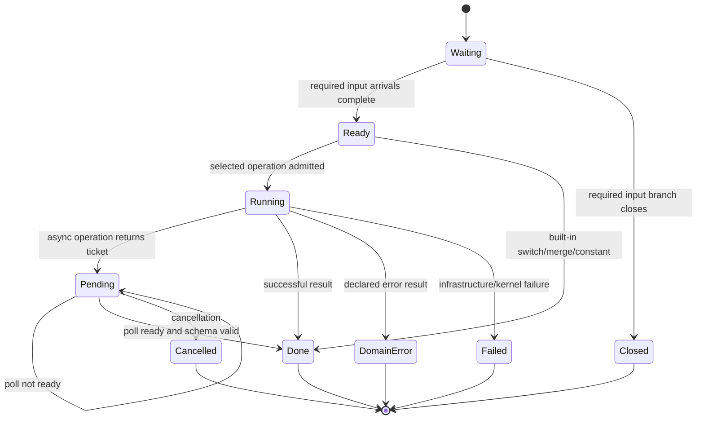

A static `Flow`/`Order` subgraph must be acyclic. Feedback requires `Deferred::Next`, a root-owned queue, causally linked wave identities, admission caps and cancellation. Bounded budgets apply to node runs, queued events, in-flight values/bytes, feedback waves and pending tickets. Overrun yields typed kernel infrastructure failure and cancellation/drain of affected tickets. Native physical worker leases must not be discarded while still active.

## 7. Plugin author-facing ergonomics

The SDK should generate the repetitive graph metadata, bindings and declaration registration from normal Rust types and typed contract operation markers. The following is **target API pseudocode**, not a claim about the current macros:

```rust
use phenix_sdk::graph::*;

// Each handler already implements an ordinary typed M1 Operation.
let mut g = Graph::contribution("example");

let submit = g.source::<PromptSubmitted>("submit");
let prepare = g.invoke::<PreparePrompt>("prepare");
let model = g.invoke::<ModelComplete>("model");
let reply = g.invoke::<ReplyCommit>("reply");

g.flow(submit.out(), prepare.input());
g.flow(prepare.ok(), model.input());
g.flow(model.ok(), reply.input());

// A disconnected flow in the very same contribution.
let on_auth = g.source::<AuthRequested>("auth");
let auth = g.invoke::<Authenticate>("authenticate");
g.flow(on_auth.out(), auth.input());

// Third-party instrumentation: source order irrelevant.
g.patch("audit").splice(
    g.edge_id("example/prepare-to-model"),
    g.invoke::<AuditContext>("audit-context"),
    pos!(1/2),
);
```

The fluent API only authors declarative graph bytes at build time. All type compatibility is independently rechecked in the offline compiler. A compact macro alternative (`graph! { ... }`) can come later, but should generate this same IR rather than create another graph engine.

### 7.1 Switch and composition-time specialization

```rust
let route = g.switch::<RequestVariant>("route");
g.flow(source.out(), route.input());
g.flow(route.case::<OpenAI>(), openai.input());
g.flow(route.case::<Anthropic>(), anthropic.input());
```

If an upstream selected provider or strategy is a **composition-time constant**, the compiler may partially evaluate the switch and remove unreachable branches *after* verification. This is graph specialization, resembling monomorphization of a workflow, **not** Rust compiler monomorphization or dynamic code generation. If selection is runtime data, the switch remains a checked runtime branch.

### 7.2 Typed Rust traits and ABI-neutral handles

Bounded embedding implementation: `GraphContributionV2::native_section()` provides
normalized, validated, size-bounded canonical bytes in the existing fixed native
graph-section envelope. Build tooling may use public contract dependencies and
generated operation metadata, then include those bytes in an exported retained
link-time static. This does not grant authority or replace offline verification.
The `experiments/graph-v2-python` fixture exercises this path with manually authored
graph structure; that experiment's Python annotations do not generate graphs or
schemas. The bounded `tools/phenix_python` frontend and `examples/python-trivial`
instead generate Rust Portable/contract/plugin macro input from one synchronous,
host-free Python operation with string or flat string-dataclass annotations, plus
a Source -> Invoke contribution using this same embedding helper. Python does
not encode ValueSchema or ContractMetadata. Unsupported annotations and async/Host
signatures reject; trusted composition policy remains outside authored metadata.
This slice is not a general graph builder or a language sandbox. The
typed builder and handles below remain proposed, not implemented by embedding.

The SDK should **reuse** the current `phenix_contract::Operation` trait as the only native handler contract abstraction. New authoring traits and typed handles exist exclusively in Rust SDK/build tooling; they lower to portable IR rather than crossing the ABI.

```rust
// Existing, retained contract semantics:
pub trait Operation {
    type Request: Portable;
    type Response: Portable;
    type Error: Portable;
    const KEY: &'static str;
}

// Proposed SDK-only typed handles. No Rust trait objects cross the ABI.
pub struct In<T: Portable> {
    id: InPortRef,
    marker: std::marker::PhantomData<T>,
}
pub struct Out<T: Portable> {
    id: OutPortRef,
    marker: std::marker::PhantomData<T>,
}

pub trait SourceSpec {
    type Payload: Portable;
    const SOURCE_ID: &'static str;
}

pub trait GraphDeclaration {
    const METADATA: StaticGraphContributionV2;
}

impl GraphBuilder {
    pub fn flow<T: Portable>(&mut self, source: Out<T>, target: In<T>);
    pub fn after(&mut self, source: NodeId, target: NodeId);
    pub fn invoke<O: Operation>(&mut self, id: &str) -> InvokePorts<O>;
}
```

`InvokePorts<O>` exposes `in: In<O::Request>`, `ok: Out<O::Response>`, and `err: Out<O::Error>`; tagged variant cases of a generic switch are generated as distinct typed outputs by SDK derives. Struct request field ports are SDK-generated projections. `flow` uses Rust type identity for ergonomic errors inside one compilation unit, but the verifier separately compares canonical **structural `ValueSchema`** across independently compiled crates. Nothing depends on `TypeId` or trait object layout at the native boundary.

Compiled graph patches can be authored through fluent builders, a declarative macro, or externally generated metadata. All three produce the **same canonical GraphContributionV2**. A `GraphPatch` is a value, not a `fn(&mut Graph)` callback run inside the kernel.

### 7.3 Graph visualization and patch explanation

Expose an inspection API returning canonical graph JSON/Value metadata plus `dot`/Mermaid exports and an origin map for each generated edge. Key queries: `show graph`, `show sources`, `show route(edge_id)`, `explain patch(id)`, `why node active`, `why patch superseded`, `why flow denied`. Keep inspection read-only; it cannot change a live graph.

### 7.9 C1 prerequisite freeze: identities and direct typed boundaries

This narrow addendum adopts the definition/instance distinction of #1188 at
`b517c746122f98f638564038067292d9376c9b9a`. It does not implement recursive
lowering, activation/completion, views, state scopes or patches.

The contract's independent `v2::composition` model leaves shipped flat
`GraphContributionV2` bytes and consumers unchanged. A `GraphDefinitionId` is
exactly `owner/local`, with both components using the existing identifier grammar
and `root` forbidden as owner. A `GraphInstanceId` is a composition-qualified
root occurrence plus an ordered path of explicit local child names. Identity is
structural, never an array index, topology hash or concatenated flat NodeId.
An instance pairs this identity with a definition ID; changing the definition
does not rename the occurrence. Instance IDs do not carry generation or authority.

A `GraphDefinition` reuses the flat declaration as its body, with matching
contributor/definition owner. Its explicitly named input/output boundaries reuse
`InputPort`, `OutputPort`, `InPortRef` and `OutPortRef`. Each maps to exactly one
existing local endpoint (extended to immediate-child aliases in 7.13), with exact complete schema, readiness (inputs) and
security equality. Boundary names are unique per direction; aliases of the same
endpoint are allowed when explicitly named. No inferred ports, relabeling,
aggregation or wrapper removal occurs. Definition validation rejects all foreign
body edge endpoints: this initial closed-body profile cannot silently expose a
crossing. Existing flat validation supplies canonical ordering, shapes and bounds;
normalization sorts boundaries and body declarations and rejects duplicates.

These Rust metadata types are not a new artifact wire format or verified input to
preparation. They validate shape only, not ownership authentication, bindings,
grants, cycles or admission. Before a lowerer is connected, freeze authenticated
definition provenance versus instance placement, nested boundary wiring and
Order/Deferred crossings, expansion bounds, effective logical anchor encoding and
global security validation. Never derive an Invoke owner from an instance name.

### 7.10 C1 structural recursive lowering freeze

This increment is a pure contract transformation, not authenticated preparation,
an artifact format, a scheduler or runtime admission. `GraphDefinition` gains
explicit named children referencing definitions and explicit named boundary Flow
wires. Existing direct boundary aliases still terminate at local body ports;
exporting a child's port directly is added by section 7.13. A wire endpoint is
either a local body port or an immediate child's named boundary, never an
arbitrary descendant or foreign node. Child names and wire names are unique.
Child definition ownership may differ from placement ownership.

Lowering expands every occurrence (no memoized sharing), in canonical definition,
child and declaration order. Logical identities pair the structural instance ID
with the original qualified declaration ID; wire IDs use a separate namespace.
Output retains original declarations and definition/occurrence provenance,
including source declarations and Invoke selectors. Placement never changes an
Invoke's declaring owner. These are structured identities, not flat wire IDs.
Root boundaries remain available through the root definition and instance.

Every Flow, including body flows, resolves real ports and requires exact candidate
schema equality and security flow compatibility without grants. Boundary aliases
still require complete input schema/readiness/security equality. Local Order edges
are preserved and participate with Flow in dependency-cycle rejection. Cross-child
Order is added by 7.14; Deferred edges are added by 7.12, never silently dropped. Definition
reference cycles and expanded dependency cycles fail closed; repeated acyclic
uses are distinct occurrences. Cardinality/readiness admission remains a compiler
obligation, not a claim made by structural lowering.

Caller budgets bound depth (root depth one), occurrences and aggregate expanded
items (sources, nodes and edges). Hard ceilings are depth 64 and the contract
MAX_COUNT for occurrence/item budgets. Before cloning/normalizing, aggregate input
declarations, ports, boundaries, children and wires are bounded by MAX_COUNT;
borrowed strings, schemas and literal trees are byte/depth checked before cloning.
Input and expanded bytes have separate MAX_BYTES ceilings, conservatively charging
canonical body bytes plus authored metadata/tree sizes (including body payloads)
per occurrence. Expanded accounting also charges repeated structural identity
paths, including empty occurrences and dependency-checking copies. This is a
resource bound, not a canonical encoding or an exact heap-size measure. Unknown definitions,
duplicate identities, invalid endpoints, unsafe flows and budget exhaustion return
failure without partial output. Unreachable definitions are shape-checked too;
7.13 extends reference-cycle checks to all supplied definitions; instantaneous
dependency cycle checks concern the selected root closure.

The lowerer does not verify recursive definitions. No output is accepted as
verified flat package metadata, and `Prepared::compile_graph_v2` retains its exact
verified-byte equality gate. Section 7.11 freezes a separate trusted-host bridge;
Authenticated recursive packaging remains future work; 7.14 adds cross-boundary Order.
Section 7.12 adds explicit Deferred activation; 7.13 adds direct nested exports.

### 7.11 C1 trusted-host executable bridge freeze

`Prepared::prepare_recursive_graph_v2` reuses normal graph-v2 preparation,
selected operation resolution, flat compilation and execution. Every supplied
definition, including unused definitions, must have a normalized body exactly
equal to its contributor's selected VerifiedPackage graph-v2 body. The trusted
control plane supplies the exact definition metadata and root and thereby
authorizes placement, boundary exposure and wiring. These boundaries are NOT
package-attested. This API is not an untrusted composition admission interface.

Lowered nodes, sources and body/wiring edges receive domain-separated hashed
owner/local IDs from their structural occurrence identities. Contributions stay
grouped by ORIGINAL contributor, including parent-owned wiring. Source references
and every edge endpoint are rewritten. The compiled plan retains ExpandedGraph
provenance. Global topology, source and delivery policy remains explicit over
exact effective IDs; a deterministic mapping helper supplies names, not authority.
Repeated ExternalAction names remain rejected by the existing compiler.

Identity includes the root and ALL normalized definitions, including unused
definitions and empty/unused boundaries, as well as the existing flat plan and
policy identity. Expansion budgets constrain admission, not semantic identity.
Unsupported source kinds remain rejected. No scheduler,
alternate resolver, package boundary attestation or new runtime is introduced.

### 7.12 C1 recursive deferred lowering freeze

Body Deferred edges retain their authored identity and occurrence provenance.
Trusted boundary wiring selects same-wave delivery with `BoundaryFlow.next = None`
or next-wave delivery with `Some(DeferredWave::Next)`. Both resolve only explicitly
exposed immediate-child ports and undergo identical endpoint, complete candidate
schema and security validation. Deferred edges are excluded from the instantaneous
Flow/Order cycle check, never rewritten to Flow. Materialization preserves their
kind and exact effective endpoints for global compilation and authorization.
Boundary delivery kind participates in recursive plan identity. Placement and
wiring remain trusted control-plane input, not package attestation or authority.

The remaining C1 work is tracked in five bundles below. None is closed by source
inspection or unexecuted acceptance assertions.

| Bundle | Starting capability | This increment | Remaining acceptance |
| --- | --- | --- | --- |
| Typed boundaries | Direct local exports and immediate-child wiring | Deferred wiring and nested aliases (7.13), acceptance pending | Exact-head multi-level native and adversarial acceptance |
| Edge semantics | Same-wave Flow and local Order | Deferred lowering and explicit cross-boundary Order (7.14), acceptance pending | Exact-head native edge acceptance |
| Logical patch anchors | Structural occurrence identity | Public/private node anchors and scoped resolver (7.14), acceptance pending | Exact-head exposure rejection acceptance; patch application remains separate |
| Canonical provenance | Body/wiring origins and effective-ID mapping | Deferred, nested alias, anchor and Order provenance/identity (7.13-7.14), acceptance pending | Exact-head provenance acceptance and patch transformations |
| Placement and authority | Verified bodies, trusted wiring, global exact-ID policy | Deferred/Order exact-policy and anchor-exposure denial assertions, acceptance pending | Complete boundary, ownership, expansion and permission adversarial acceptance |

### 7.13 C1 immediate-child nested boundary alias freeze

This extends the direct-local-only boundary profile in 7.9-7.11. An input target
is `BoundaryTo::Local(InPortRef)` or `BoundaryTo::Child { child, port }`; an output
source is the corresponding `BoundaryFrom`. A Child hop names only an explicitly
declared immediate child and one of its named public boundaries. A child boundary
may itself alias another immediate child, to arbitrary levels within the existing
depth bound. Descendant path strings, hidden child body ports, implicit
aggregation and wrapper invocations are not supported.

Every hop requires exact full schema, input readiness and security equality after
renaming only the boundary name. All supplied definitions, including unreachable
ones, are shape/link checked. Unknown child definitions, missing named aliases,
invalid local ports and definition-reference cycles fail before native loading.
Selected occurrence expansion remains bounded by ExpansionBudget depth and
occurrences; items now also charges every retained alias-chain hop. Alias-chain
identity bytes are charged before cloning against expanded MAX_BYTES. Empty
occurrences still consume depth/occurrences. No alias traversal can bypass these
limits. Flow/Order cycles remain invalid after leaf resolution; Deferred Next
is typed and checked but excluded from the instantaneous cycle graph.

ExpandedGraph retains separate canonical input/output maps keyed by occurrence
and authored boundary name. Each BoundaryProvenance contains the resolved real
LogicalPort and every named alias in outer-to-leaf order, including the local
terminal alias. Children resolve before their parents without memoizing occurrence
identity. Wiring uses these resolved endpoints; original declaration owners,
body/wire origins and complete GraphInstanceId paths are preserved. Sorting
definitions, children, boundaries and wiring makes input permutations immaterial.

Recursive identity metadata includes the Local/Child discriminator and the local
node/port or child/boundary name of every alias, including unused aliases and
definitions. Bodies remain package-attested; host placement, wiring and alias
metadata are trusted control-plane input, not package attestation or authority.
Global compilation still requires exact effective source/topology/delivery grants;
names, ancestry and aliases grant nothing. InvokeEach recursive lowering remains
explicitly unsupported. No executor, dispatcher, pending manager or Basic gate
changes are part of this increment. The five bundles in 7.12 remain independently
open pending normative requirements AND exact-head acceptance, including the
three-level repeated-occurrence native fixture and pre-constructor denials.

### 7.14 C1 scoped logical anchors and boundary Order freeze

`GraphDefinition.anchors` is a canonically name-sorted list of `GraphAnchor {
name, visibility, target }`. Names are unique identifiers in their own namespace;
visibility is Public or Private. `AnchorTarget::LocalNode` names an existing node
in this definition's closed, package-attested body. `AnchorTarget::Child` names
one declared immediate child and one of that child's PUBLIC named anchors.
Public re-export through multiple such hops is allowed. Private child anchors
cannot be used or re-exported, even by a private parent anchor. An own public
anchor deliberately exposing a local body node is allowed independently of any
other private alias of that node. No descendant path strings, raw-node lookup
fallback, implicit anchors or foreign body-node targets are supported.

`GraphDefinition.orders` is a separately name-sorted list of `BoundaryOrder {
name, before, after }`. Each `AnchorRef` is Local(named own anchor, public or
private) or Child(immediate child, PUBLIC named anchor). Order names are unique
within their namespace, distinct from Flow wire and body-edge identities.
Lowering resolves each reference to an actual LogicalId and emits existing
`LogicalEdge::Order` / `EdgeKind::Order`, retaining original contributor ownership.
Order means only execution dependency on that exact exposed node. It neither
activates the after-node nor transports values, resources or authority. It is
not child start/finish, whole-subgraph completion, a scheduler or an executor.

ExpandedGraph retains `AnchorProvenance` (visibility, resolved node, every alias
outermost to local terminal) and `OrderProvenance` (both complete anchor chains).
`ExpandedGraph::resolve_anchor(scope, reference)` is the public structural
selection contract for future logical patch selection: own private anchors may
be selected only as Local in that occurrence; Child lookup requires public
exposure and a declared immediate-child occurrence. It applies NO patches and
grants NO permissions. ExpandedGraph is descriptive trusted-host diagnostics,
not authenticated SDK input or an authority token, including its private maps.

All supplied definitions, including unused ones, validate anchor/order names,
local ownership, child/public exposure and reference links before native loading.
Definition cycles are rejected. Selected expansion uses the existing bounded
depth/occurrence limits; input counts include anchors and orders; expanded items
include every retained anchor and Order provenance hop plus Order edges. Borrowed
metadata is byte-checked before normalization, and expanded identity chains are
charged before cloning. The existing global instantaneous Flow/Order cycle check
runs after endpoint expansion, excluding typed Deferred Next admission edges.

Canonical identity includes all anchor visibility, target kind, node or child/
anchor names, and Order names/references, including unused/private metadata.
Permutations do not alter identity. Public exposure, names, ancestry and membership
infer no grants: exact effective-ID topology/source/delivery and original-owner
operation policy remain mandatory during global compilation. Bodies still match
their contributor's selected package; no unattested empty container is introduced.
This is bounded metadata algebra and resolution only, NOT a graph-patch engine.
Recursive InvokeEach remains unsupported; generic Each/Basic execution is unchanged.
The five C1 bundles in 7.12 remain independently open until normative AND all
exact-head acceptance passes, including held-native-A versus ready distinct-B
ordering, no-Flow nonactivation, provenance isolation and pre-constructor denials.

## 8. Module and file plan

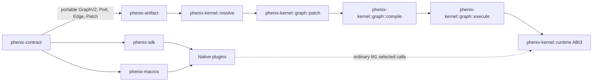

Suggested concrete source layout:

```text
crates/phenix-contract/src/graph/
  mod.rs             V2 canonical declarations, type IDs
  node.rs            NodeKind, typed ports, policies
  edge.rs            EdgeKind, port refs, logical IDs
  patch.rs           GraphPatch, GraphEdit, exact Position
  canonical.rs       V2 encode/decode/normalization
crates/phenix-kernel/src/graph/
  mod.rs             Public Prepared::compile_graph, CompiledGraph
  patch.rs           Target matching, dependency/conflict algebra
  compile.rs         Normalize/materialize/type + grant checks
  plan.rs            Flow reachability, join groups, readiness plan
  execute.rs         GraphExecution, value delivery, pending lifecycle
crates/phenix-sdk/src/graph.rs
  Typed contributor, node, edge and patch authoring helpers
crates/phenix-macros/src/graph.rs
  Typed event/operation metadata derivation (reuses existing macros)
crates/phenix-artifact/src/...
  Offline graph-v2 section verification
```

Streaming/approval/budget/tool-batching logic belongs in the existing Model, Tools, Agent, Frontend, Session/Storage and Observer plugin families, potentially as reusable domain contract crates, not new core subsystems. Generic pending/cancellation/authority remain kernel-owned.

Keep all domain-specific operations as normal selected contracts in their existing plugins. **Do not** introduce a `GraphManager` plugin, a second event dispatcher, or an on-disk mutable graph state service.

## 9. Migration plan and acceptance gates

| Gate | Deliverable | Must prove |
|---|---|---|
| **V0** | Formal wave/port/failure/authorization semantics + canonical graph-v2 schema | Source reachability, closure/failure reduction, root lifecycle, metadata bounds, no unauthorized flow |
| **V1** | **Native ABI-3 vertical slice:** `Source → Invoke → Flow → Invoke` | Schema checks, runtime scope, pending/cancel/drain, domain `err`, no duplicate delivery, M1 direct-call parity |
| **V2** | Switch, Merge, Join, source/constant and branch-closure rules | Cross-source valid merge, impossible join rejection, closure liveness, deterministic failure precedence |
| **V3** | Deterministic graph patches: add/remove/splice/replace and exports | Commutativity, exact positions, supersession/export binding, negative authority tests, bounded processing |
| **V4** | `Deferred::Next` with bounded same-root waves | Finite roots, cycle rejection, wave/byte/ticket limits, cancellation and draining |
| **V5** | Typed SDK ergonomics and temporary graph-v1 lowering bridge | Provider/tool/agent and ACP parity, same event-settlement/state-watch semantics, retirement plan for v1 |
| **V6** | **Plugin-scaffolding acceptance gate**, not additional kernel architecture: selected streaming observer contract + durable approval + batched tools | Native streamed tool request with approval/checkpoint/new-root admission, bounded delivery, per-tool grants; kernel remains unchanged unless native test proves a missing generic guarantee |
| **V7** | Inspection/explain/provenance and plugin migration | Stable versioned extension points, protected diagnostics, no parallel dispatcher/capability catalogs |

**Security admission gates start at V0 and are enforced in V1.** Fine-grained classification/declassification testing is not deferred until graph patches are allowed to connect privileged ports. Existing M1 verifier, ABI-3 selected invocation, authority and cancellation are reused. Full patch algebra is deliberately after a functional typed delivery slice; default agent-harness integration is plugin composition, not a prerequisite for a new kernel API.

**Regression gates:** exact-head Rustfmt, native Nix/M1 conformance, ACP integration, pending/cancellation physical lease tests, state-watch epoch equivalence, event settlement failure semantics, multiple triggers on one node, `after` nonactivation, inactive source closure and v1/v2 temporary adapter fidelity. These are requirements, not claims that a PR has passed.

### 9.1 Determinism/property-based test examples

1. Permuting node/edge declarations never alters compiled graph identity.
2. Permuting independent patches never alters effective topology, provenance decision order or diagnostics semantics.
3. Splice at 1/5 and 1/2 yields `A→D→C→B` regardless of package order.
4. Same-position splices with no distinct `splice_order` values are rejected; explicit smaller `splice_order` is closer to the source.
5. Multiple exclusive replacements without complete, distinct priorities are rejected; one winning replacement leaves traceable supersession records.
6. Replace+splice of the same original edge is rejected unless the splice depends on an explicitly exported anchor from the effective winning replacement.
7. A plugin may author disjoint trigger components without a global entry point.
8. Ordering-only edges do not activate nodes or connect unrelated execution roots.
9. Switch takes exactly one tagged case; other paths emit `Closed`; `Merge::ExactlyOne` receives one value; `Join::All` never waits for a provably closed branch.
10. Two independent root activations, even of the same source, never share in-flight edge values.
11. A malicious patch retargeting an authorized tool to an unauthorized plugin or sensitive port fails before native load.
12. An asynchronous node never forwards output before its selected ticket resolves; cancellation prevents effects on downstream nodes.
13. A deferred cycle is bounded and cancellable; an instantaneous cycle fails compilation.
14. A graph with the same topology but distinct artifact bindings yields a distinct prepared generation identity.
15. `Join::All` with independent-only trigger sources is rejected; an alternative cross-source `Merge::ExactlyOne` remains valid.
16. Switch-exclusive paths are not incorrectly deemed satisfiable inputs to the same required join.
17. An active failure takes precedence over closure regardless of pending-operation arrival order.
18. A consumer marked non-runnable drops late success values but does not implicitly cancel its upstream pending producer.
19. A persistent source firing twice creates two separate external roots; plugin events/deferred create same-root waves.
20. Superseded patch exact dependencies fail; compatible `EffectiveExport` dependencies retarget only to unique effective winning exports.
21. Two applied patches exporting the same qualified name without supersession reject deterministically.
22. Confidential-to-Public declassification without verified metadata **and** a composition grant rejects; malicious graph patches cannot relabel a native port.
23. A confidential default and a constant containing an owner-scoped `Value::Ref` are rejected.
24. Flow authorization valid in one resource-scoped root does not leak into another root.
25. Formal codec fuzzer rejects malformed or oversized nodes, patches, collisions, dependency cycles and noncanonical IDs.
26. Native harness fixture: streaming model reply, tool proposal, durable approval checkpoint, new-root resume, and account-scoped tool execution.
27. Behavioral replay with recorded model/tool outputs is distinguished from topology-only decision replay.

### 9.2 Additional v2.4 contract tests

1. For a `Switch` on Confidential input, branch-output payload **and** public trace/branch indication cannot be classified Public without verified declassification.
2. A source-triggered `Constant` without `start: Flow<()>` remains dormant; an `Order` edge alone cannot activate it.
3. `StaticMany(min=0,max=3)` of one value, one closed edge and one value emits two values in ascending EdgeId order; `StaticMany(min=3,max=3)` closes for insufficient cardinality; any unhandled failure fails either collection.
4. Transferring `Value::Ref` with an authorized flow but without owner-scoped read access permits delivery but denies dereference.
5. A source declaration exceeding the verified owner ceiling or composition ceiling rejects before `dlopen`.
6. An effective-export winner with a different security label rejects under exact-match expectation; an explicitly bounded range succeeds only if flow and declassification policy also allow it.
7. `HardRequired` rejects a missing, bypassed or unprovably exclusive cost-bearing effect path. `Advisory` reports its limited guarantee.
8. A nested switch/merge/join that local analysis cannot prove returns `Satisfiability::Unknown` with a deterministic diagnostic and cannot deadlock at runtime.
9. An observer lacking a selected scoped stream grant receives no chunks, even if it discovers the stream ID. Cross-root and over-classification chunks are denied.
10. A loop exceeding its agent turn quota terminates with plugin-owned policy result *before* generic kernel wave exhaustion.
11. Negative `splice_order` and an independent `AddEdge` touching a `ReplaceNode` incident port reject at preparation.

## 10. Agent-harness fit and ownership (no agent concepts in the kernel)

**Design boundary:** The default agent is a plugin-authored graph plus domain contracts, not a kernel-owned ReAct state machine. Phenix supports generic scheduling, typed contracts, authority, lifecycle and cancellation. It is not responsible for ChatGPT/OAuth semantics, model tokens, human approval decisions, tool schemas, cost billing or persistent session state. Where the generic substrate lacks a guarantee necessary for *all* domains, extend it only after a concrete vertical test demonstrates the gap.

### 10.1 Ownership decision matrix

| Harness capability | Plugin/domain ownership | Generic kernel responsibility | Kernel extension decision |
|---|---|---|---|
| Model and UI streaming | Model transport decodes SSE/token/tool-call deltas; frontend/observer emits incremental UI updates; event journal may persist selected chunks | Existing pending/poll/wake, cancellation, authorized observer invocation and physical work lifetime | **Not by default**. Add bounded generic stream transport/backpressure only if selected observer/transport contracts cannot provide it without replicated scheduler logic; do not create one graph wave per token |
| Human/tool approval | Agent determines whether approval is required; approval plugin stores pending intent and correlation; frontend renders UI; session/storage plugin checkpoints | Authorization of new external resume action, selected grant checks, generation and cancellation semantics | **Not by default**. Durable *resurrection of the exact kernel root/ticket stack* would be a genuine new kernel feature, and is explicitly out of scope |
| Dynamic N tool calls | Agent parses output; tool manager validates registered names/schema, maps each call to resolver-selected attested tool executor and handles result aggregation | Existing scoped selected invocations, cancellation and grant checks | **Optional** generic dynamic fork/join only if graph-level per-call scheduling/observation is required; no runtime graph mutation or untrusted model-selected provider IDs |
| Token/cost/wall-clock/tool budgets | Agent/provider/tool meter owns billable usage and domain policies; shared budgets plugin can expose a selected enforcement contract | Generic root admission limits: waves, nodes, calls, bytes, pending tickets, queue depth, cancellation | **Conditional** mandatory per-effect hooks or capability-checked quota reservation if independent domain plugins can otherwise bypass selected enforcement paths; kernel does not interpret tokens/currency |
| Durable conversation/memory | Session/storage/checkpoint plugins own history, CAS, idempotency and recovery | Root/generation isolation and safe new-root admission | **No**, unless durable live-root snapshots are required |
| Multi-agent/sub-agents | Agent/workspace/session plugins own child tasks, delegation, durable correlation and result collection | Existing generic admission and authority boundaries | **Optional future** child-root structured concurrency if required; M1 serial roots prohibit claiming concurrent nested roots |
| Deterministic replay | Journal and deterministic mock Model/Tool plugins record/reinject nondeterministic results | Canonical topology, patch decisions, execution order and provenance | **No** domain replay engine in kernel; topology determinism does not imply identical model results |
| Named customization hooks | SDK/default agent plugins publish stable named extension anchors that lower to ordinary patches | Canonical offline patch validation, grants, conflict resolution | **No** special kernel knowledge of prompts, tools, memory or agent turns |

### 10.2 Example: plugin-authored base loop

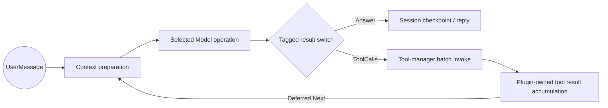

**Loop-specific safety:** `Deferred::Next` consumes a generic kernel wave. Kernel wave/count/byte ceilings are a last-resort safety backstop, **not** an agent turn/iteration/tool quota. The Basic Agent and selected policy/metering plugins must enforce configured turn count, tool-call count, model token/cost reservations and stopping criteria *before* exhausting kernel ceilings. Exhausting a kernel wave limit is an infrastructure termination, not a successful agent-policy stop. The loop domain must record a typed terminal budget/limit outcome and checkpoint state when its semantic budget is reached.

The generic executor routes **discrete** typed operation completions. Streaming token/chunk delivery is a separate selected transport/observer interaction with its own flow control; the graph does not need a `Flow` edge for every token. The tool manager may perform a runtime-sized batch of already authorized selected invocations; the graph edge sees a typed `ToolCallBatch`/`ToolResultBatch`, and each individual executor remains bound to a trusted registered identity. This is a deliberate granularity choice, not dynamic graph editing. If a product requires graph-visible individual tool calls/forks, propose a *generic* runtime fork operator with explicit bounds and type-checking, backed by a native acceptance test.

### 10.3 Approval is a durable workflow checkpoint, not a sleeping native root

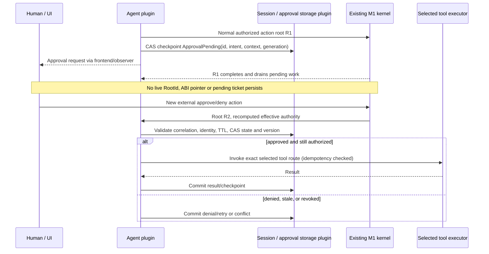

**Required invariants:** correlation token is not a capability by itself; authenticate the approving principal and recheck current scope, tool identity, expiry, resource/credential grants and account selection on resume. Persist a durable intent with an idempotency key and CAS revision. The first root must complete or be cancelled cleanly before external waiting begins. The resume root does **not** inherit R1's authority or live tickets; it is admitted afresh under R2's authority. This is a plugin-owned workflow protocol using ordinary selected storage and frontend contracts. A generic kernel `SuspendRoot`/`RestoreRoot` would be needed *only* if the requirement explicitly demanded serialization of the live dispatcher/tickets and cross-process restoration of the identical root; that is a much larger ABI and safety project and not a P1 requirement.

### 10.4 Streaming and backpressure boundary

The stream observation route has its own **plugin-contract authorization descriptor**, not an implicit graph `FlowGrant` or open event broadcast. Its minimal verified and selected representation is:

```rust
struct StreamObserverGrant {
    stream: StreamIdentity,              // Issuer/provider, operation and account/session identity
    observer: SelectedObserverBinding,   // Prepared, authenticated import route
    maximum_classification: Classification,
    resources: ResourceScope,
}
```

The stream owner checks this policy **per root and per chunk** against the effective root scope and actual chunk classification; the composition's selected M1 grants must also authorize the observer operation. No observer is added merely by declaring a subscription. A producer may select only prepared, authorized observers; it must never trust a payload-supplied plugin identity or account. The verified stream-observation policies and decisions appear in the **composition security/explain report** alongside graph patch decisions, with stream identities redacted as necessary. This is a selected domain contract, **not** a new kernel stream scheduler or native ABI table entry.

A selected Model transport owns its HTTP/SSE or equivalent parser and its private network worker. The selected frontend/observer contract owns presentation. For the first harness slice, use existing asynchronous pending/poll/cancel primitives plus a **bounded, acknowledged chunk-delivery contract** between the provider/transport and its selected observer or journal when necessary. Chunk records contain authenticated invocation/account identity and monotonic sequence numbers; unauthorized observers never subscribe by default. Define bounded buffers, cancellation of producers and consumers, dropped/disconnected observer behavior, and whether intermediary chunks are durable. A completed Model operation still produces one canonical typed terminal response along ordinary graph `Flow` edges. Streaming is not a new general graph edge type unless experiments show selected stream contracts cannot safely compose independent middleware or enforce backpressure.

### 10.5 Runtime tool fan-out boundary

#### Priority B bounded InvokeEach freeze (30 October 2026)

This addendum defines the intended next increment, not an implementation or
acceptance claim. `InvokeEach` is one authored node with one complete
`in: List<Struct{route: U64, input: T}>` and one
`out: List<Tagged{Ok: U, Err: E}>`. Its declaration names one selected collection
slot, one operation key, an optional self route, and a nonzero maximum membership
of at most 256. Preparation freezes collection routes in selected ordinal order,
followed by self when enabled. All routes must have identical request, response,
error schemas and attested port security. Every route requires the declaring
owner's existing operation grant. Route ordinals select existing authorizations;
they never identify providers or grant authority. Collection cardinality and
route order are generation-local and participate in the prepared identity.

The complete finite list, every route ordinal and every request schema must be
validated and charged against root limits before the first effect. Invalid
membership, overflow or an out-of-range route fails without starting a branch.
An empty list emits an empty result immediately. Branch identity is the
host-issued original zero-based list ordinal supplementing root, activation and
authored node. Branches retain independent existing dispatcher tickets and
attenuated authority. Scheduling scans all eligible branches: a busy provider
cannot block a distinct provider, and physical calls to the same provider remain
serialized. There is no second executor, graph mutation or domain kernel API.

Each admitted branch contributes exactly one typed Ok or Err outcome. Domain
failure does not cancel successful siblings. Results collect in original list
order, never completion order. Publication waits for every admitted outcome AND
physical drain. Duplicate or late completions cannot replace an accepted outcome
or publish twice. Infrastructure failure stops admission and cancels/drains all
started siblings through the existing root ticket tree. Cancellation prevents
publication, including late success. Existing root/generation/resource and
classification checks apply independently to every invocation and delivery.

Basic's V2 stages must separately admit/checkpoint the exact Model reply and
pending call IDs before effects, map names through BasicTools' sealed catalog to
route ordinals, invoke branches through InvokeEach, then validate exact ordered
correlation and reconcile outcomes before preparing the deferred Model request.
Branch handlers cannot concurrently mutate Basic's Running state. Infrastructure
failure retains the durable pending calls for explicit recovery; domain failures
become tool outcomes without erasing successful siblings. V1 remains unchanged.
Recursive C1 lowering must either account for this operator completely or reject
it explicitly before producing lowered metadata. Native controlled-pending
distinct-provider overlap, reverse-order completion, mixed domain outcomes,
empty/single/multiple admission, duplicate IDs/results, cancellation/late success,
and the packaged normal multi-tool path are required acceptance, not implied by
this freeze.

**Basic integration freeze (30 October 2026):** V2 adds domain-only
`BasicGraphTools::{admit,reconcile}`, `ToolGraph::{validate,plan,collect}` and
`ToolGraphExecutor::{list,validate,invoke}` contracts. The existing V1 ToolRegistrations
contract is unchanged. An invocation carries session, run, monotonic model-turn
batch ordinal and the exact call (ID, registered name, arguments); both typed
success and domain failure echo that complete invocation. BasicTools owns the
InvokeEach node over its declared selected GraphContributors collection, with
the builtin executor as the final self route. Its V2 catalog and planner use
that same sealed collection. A Join carries the immutable admitted batch beside
the ordered outcomes. Tools collect and Basic reconcile independently require
exact cardinality and positional invocation equality, rejecting duplicate,
foreign or reordered results before committing outcomes. No branch accesses
Basic Running state. ToolGraph.validate is a selected pure validator called
before durable admission; plan repeats that same sealed validation. Invalid JSON,
builtin argument types, names and membership cannot create pending tool work.

**Durable partial-outcome freeze (30 October 2026):** Each admitted executor
MUST persist its exact typed terminal outcome through an independent selected
ToolReceipts provider before returning success or domain failure. Immutable
per-invocation receipts use the existing atomic Storage CAS contract, checking
the batch fence and creating the immutable receipt in one transaction, not concurrent
Session/Running mutation. Normal collection verifies every receipt. A batch seal
fences further executor writes. Cancelled/draining callbacks never write receipts;
failure to persist a terminal outcome is infrastructure failure, not a fabricated
domain result. Receipt identity includes the complete invocation and call input.

Only separately authorized post-drain host finalization or fenced owned-run
recovery may seal an interrupted batch and import its durable receipts through
GraphToolSession.recover. Session retains known outcomes and only unresolved
calls remain pending; known success is never relabelled uncertain. Recovery
reassembles tool messages in original invocation order and cannot overwrite an
existing result. A separate operator-authorized resolve operation may supply a
missing receipt after sealing; it cannot replace an existing receipt. Recovery
never advances Model or retries effects. Receipt -> Session/Storage dependencies
are acyclic; no Contributor -> Tools callback or second scheduler is introduced.

The selected tools manager accepts a bounded `ToolCallBatch` with opaque model-provided *registered tool IDs plus arguments*, validates each against the attested, generation-local catalog, and routes execution through **preselected kernel-authorized contract bindings**. The model never supplies executable plugin identity or import index. Each tool call retains distinct ID, per-tool schema check, cancellation status, resource grant and result/error identity. The manager publishes a bounded batch result to the graph. This keeps P1 functionality without making static graph metadata depend on runtime MCP discovery. Runtime-discovered tools become usable only after authenticated, policy-approved registration/catalog refresh with verifiable executor bindings; dynamic code installation is a distinct generation/composition problem.

If per-tool execution must become independently graph-editable, observable or joinable, define a generic `ForkMany<T>`/`CollectMany<T>` contract with bounded cardinality, closure and branch correlation. Do not add an agent-specific kernel tool fan-out API.

### 10.6 Budget placement and guarantees

**Product composition gate:** A composition may declare `BudgetMode::Advisory` or `BudgetMode::HardRequired` for a named economic resource/account. Under `HardRequired`, preparation must verify that **every selected, declared cost-bearing effect** has a trusted route through the designated reservation/enforcement contract under the same account/resource scope; absent, ambiguous or bypassing routes reject the composition. Its verified effect metadata must identify the effect class and enforcement binding. Permission to patch or invoke an alternate provider must not introduce an uncovered cost-bearing path. At runtime, the owner checks/reserves before the effect and reconciles after it.

This is **not** proof of an absolute monetary cap against malicious native plugins that can perform arbitrary unmediated network I/O or providers that bill beyond the reserved estimate. If full effect mediation is not verifiable (e.g. no suitable native sandbox or trusted transport boundary), `HardRequired` is unsupported and **must be rejected**, not silently downgraded to advisory. The enforceable guarantee must name its scope (e.g. call admission, bounded token reservation, provider-side hard cap). The kernel still owns only generic execution ceilings; domain billing declarations, enforcement and costs remain plugin-owned.


The kernel maintains generic, bounded **execution resources**—root/wave counts, node invocations, pending tickets, buffered bytes, queue sizes, and cancellations. Plugins own semantic counters: token usage, dollar cost, tool-call policy, model-specific context limits, and session quotas. A shared budgets plugin can issue account/session-scoped reservations before expensive effects, reconcile observed usage and request cancellation. For hard enforcement, *all* cost-bearing model/tool effects must be mediated by a selected enforcement-capable path; if third-party effects can bypass it, the claimed hard budget is not enforceable. Runtime admission can enforce only generic resource ceilings without knowing provider billing units. Actual dollars/tokens often arrive after the effect, so a truly hard upper bound on remote billing may not be achievable without provider-side enforcement/reservation.

### 10.7 Versioning, extension points and replay

Default agent plugins publish named, typed, versioned extension points (for example `agent.input.before-prepare@1`, `model.before-invoke@1`, `tools.after-execute@1`). These lower to ordinary logical graph anchors and patches. Customizers should generally select a hook, operation replacement or policy registration; raw patch algebra remains an advanced surface. Upgrades maintain an explicit extension-point compatibility/deprecation policy; graph generation identity prevents unsafe accidental reuse but does not itself prevent ecosystem breakage.

The compiler guarantees canonical graph topology, grant and patch-decision identity—not deterministic network/model responses. **Behavioral replay** requires durable recording of nondeterministic model/tool outputs, relevant external inputs and selected policy decisions, with privacy controls and revalidation. Replay fixtures can substitute recordings at the selected contract boundary; no model-specific replay logic enters the kernel.

### 10.8 Harness end-to-end acceptance gate

Prove one native scenario on ABI 3: user prompt -> streamed selected model output -> typed tool request -> durable approval intent -> first root clean completion -> human approves via external event -> new authorized root -> exact attested selected tool execution -> persisted tool result -> resumed model turn -> streamed final answer. The gate tests revoke between approval and resume, duplicate approval, restart/crash recovery, cancellation/backpressure, partial tool batches, plugin grant denial and no cross-root leak. It must pass without introducing a tool-specific scheduler or persisting a live root.

## 11. Non-goals and important constraints

- No runtime hot-mutation of an active graph. Reload means a **new prepared generation** with independently validated patch set. Old in-flight roots retain old generation semantics until they finish/cancel.
- No arbitrary plugin-generated imperative compiler callbacks during `Prepared::prepare`, no execution prior to offline validation, no graph edits from model-provided tool calls.
- No presumption of unconstrained kernel concurrency, and no detached async work introduced by `Deferred`.
- No additional provider, OAuth, Model or Agent concepts inside the kernel; graph primitives remain domain-independent.
- No Rust `dyn Trait` crossing ABI; portable `Operation` contracts and canonical values stay the interface boundary.
- No implicit authority or dataflow rights arising from graph connectivity, patch priority, source events or returned references.
- No automatic resolution of semantically noncommutative graph rewrites by alphabetical plugin name or input declaration order.

## 12. Main decision and rationale

**Build a graph IR + deterministic patch algebra + typed dataflow scheduler; retain ABI-3 and the existing M1 resolver/dispatcher. Treat the agent harness as composed plugin behavior, not as a kernel domain.** In this model, user-facing event subscriptions are typed edges from source nodes, interception is graph splicing, provider substitution is a selected-operation or node replacement, branching is a switch, and advanced agent loops use deferred causal feedback. All of these features share one set of compiler/runtime invariants instead of accumulating bespoke plugin systems.

### Source anchors reviewed

- [Current M1 graph declarations](https://github.com/matthis-k/phenix-ai/blob/main/crates/phenix-contract/src/graph.rs)
- [Current M1 graph compiler/executor](https://github.com/matthis-k/phenix-ai/blob/main/crates/phenix-kernel/src/graph.rs)
- [Contract `Operation` and `Portable`](https://github.com/matthis-k/phenix-ai/blob/main/crates/phenix-contract/src/lib.rs)
- [ABI 3 tables and reply/value ownership](https://github.com/matthis-k/phenix-ai/blob/main/crates/phenix-contract/src/abi.rs)
- [Prepared composition, selected bindings, grants](https://github.com/matthis-k/phenix-ai/blob/main/crates/phenix-kernel/src/resolve.rs)
- [Event-driven migration progress — active draft branch](https://github.com/matthis-k/phenix-ai/blob/feat/basic-agent-run-events-20261025/docs/plugin-event-migration-progress.md)
